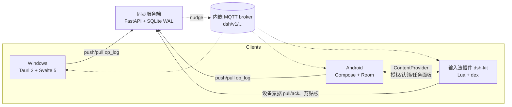

# 待办清单 · To-Do List

一个**离线优先、多端实时协作**的待办清单：Windows 桌面端、Android 客户端、Python 同步服务端，外加一个跑在中文输入法里的推送/剪贴板插件。

- 数据以**只追加的 `op_log`** 为唯一事实来源，业务状态由确定性投影算出；合并只用字段级 LWW + 集合 OR-Set。
- 三端共用同一套 HLC 与投影规则，`shared/testvectors` 是跨端一致性基准。
- 新数据通道（dsh）统一了推送、提醒与剪贴板：`nudge → pull → ack`，MQTT 只做唤醒，数据库才是真相。
- 提醒支持提前量、免打扰、稍后提醒、补发；手机上与输入法插件共用**单一展示者**，不重复弹。

## 架构



- **服务端**：唯一授权入口，按 op 的 HLC 时刻裁决成员角色；单进程 Writer 持有唯一可写连接，读走 `query_only` 连接池。
- **客户端**：所有写操作先落本地 `op_log`（单事务），再异步 push；pull 到的 op 幂等入库，投影随之更新。
- **输入法插件**：不持有账号密码，由 App 签发**设备级凭证**自主续期；剪贴板逻辑全部留在插件内（App 后台权限不足以持续监听剪贴板）。

## 目录

```text
server/        Python 3.12 + FastAPI + aiosqlite 同步服务端（op_log / 成员 / 快照 / dsh 推送）
windows/       Tauri 2 + Svelte 5 桌面端（主窗口、便利贴、日历、统计、AI、提醒、托盘）
android/       Jetpack Compose 客户端（多模块：domain/data/network/sync/dsh/reminder/feature-*）
ime-plugin/    中文输入法2 插件（dsh-kit）：推送 0–7 级、剪贴板同步、待办面板
shared/        protocol schema 与跨端 testvectors
docs/          协议、设计、UI 规格与交付清单（见下方索引）
plans/         产品与阶段计划
```

## 快速开始

### 1. 服务端

```powershell
cd server
py -3.12 -m venv .venv
.\.venv\Scripts\Activate.ps1
pip install -e ".[dev]"

$env:TODO_SERVER_JWT_SECRET = "<至少 32 字节随机串>"
uvicorn app.main:app --host 0.0.0.0 --port 8000 --workers 1
```

健康检查 `GET /v1/health`。**必须单进程**（启动时抢 `<db>.lock`）；配置项见 [`server/README.md`](server/README.md)。
要收推送还需让手机可达 MQTT 端口（默认 1883），并设置 `TODO_SERVER_DSH_MQTT_PUBLIC_HOST`。

### 2. Windows 桌面端

```bat
cd windows
npm install
npm run tauri dev        :: 原生窗口
npm run dev              :: 浏览器预览 http://127.0.0.1:1420
```

Release 构建与数据位置见 [`windows/README.md`](windows/README.md)。

### 3. Android 客户端

```powershell
cd android
.\gradlew.bat :app:assembleDebug
.\gradlew.bat :app:assembleRelease
.\gradlew.bat test
```

真机联调时把服务器地址填成电脑内网 IP；明文 HTTP 已在 `network_security_config.xml` 放行。详见 [`android/README.md`](android/README.md)。

### 4. 输入法插件（可选）

```bash
# Linux / WSL
bash tools/build.sh
# Windows
powershell -ExecutionPolicy Bypass -File tools\build.ps1
```

部署：把 `out/dsh-kit.dex` 推到 `/sdcard/Documents/rime/scripts/`，再强停一次输入法。详见 [`ime-plugin/README.md`](ime-plugin/README.md)。

## 数据与同步模型（摘要）

| 概念 | 约定 |
| --- | --- |
| 唯一事实来源 | `op_log`（只追加，禁止物理删除；删除写 `__deleted` 墓碑） |
| 合并 | 字段级 LWW；集合字段用 OR-Set；全序由 HLC `(physical_ms, counter, node_id)` 决定 |
| 客户端写 | 单 Room 事务写 op → 触发同步；UI 不直接发 HTTP |
| 推送 | 每批 ≤500 op，先 push 后 pull；`server_seq` 为全局游标 |
| 冲突/授权 | 服务端按 op 的 HLC 时刻的成员角色裁决，被拒 op 标记 `rejected` 并排除出投影 |
| 测试基准 | `shared/testvectors/*.json` 三端共用；`core:domain` 有性质测试 |

## dsh 数据通道（摘要）

- 设备注册：`POST /v1/dsh/devices/register`（Bearer）→ `device_id` + 10 分钟票据 + MQTT 端点。
- 设备凭证：`POST /v1/dsh/devices/{id}/credential` 签发；`POST /v1/dsh/devices/refresh` 续期并**轮换**（无需账号密码）。
- 收消息：MQTT 只推 `{"t":"nudge"}`；客户端 `pull` → 应用 → `ack` → 推进本地游标。
- 剪贴板：默认 `clip_persist=false`，只走 MQTT 直传，设备离线即丢弃；剪贴板逻辑只在输入法插件内。
- 提醒去重：业务键 `(workspace_id, task_id, remind_at_ms)`；App 与插件通过 `dsh_claim` 表跨进程认领，只有一个 winner。

完整协议：[`docs/server-protocol.md`](docs/server-protocol.md) 第十五节；客户端协作：[`docs/android-ime-dsh-channel.md`](docs/android-ime-dsh-channel.md)。

## 文档索引

| 文档 | 内容 |
| --- | --- |
| [`docs/server-design.md`](docs/server-design.md) / [`docs/server-protocol.md`](docs/server-protocol.md) | 服务端设计与 HTTP/MQTT 协议 |
| [`docs/collaboration-model.md`](docs/collaboration-model.md) | 成员、角色与授权裁决 |
| [`docs/subtask-model.md`](docs/subtask-model.md) / [`docs/reminder-and-tag-model.md`](docs/reminder-and-tag-model.md) | 子任务、提醒与标签语义 |
| [`docs/task-time-and-scope-model.md`](docs/task-time-and-scope-model.md) | 开始时间、今天/全部、分组与联动 |
| [`docs/ime-push-client.md`](docs/ime-push-client.md) | 输入法插件设计、provider 契约、排障 |
| [`docs/android-ime-dsh-channel.md`](docs/android-ime-dsh-channel.md) | App × 输入法通道委托与提醒去重 |
| [`docs/windows-frontend-spec.md`](docs/windows-frontend-spec.md) / [`docs/design-tokens.md`](docs/design-tokens.md) | Windows 前端规格与设计令牌 |
| [`docs/ui-implementation-spec.md`](docs/ui-implementation-spec.md) / [`docs/ui-delivery-checklist.md`](docs/ui-delivery-checklist.md) | UI 实现规格与交付清单 |
| [`docs/ai-intent-contract.md`](docs/ai-intent-contract.md) | AI 意图契约 |
| [`docs/release-2026-11-stable.md`](docs/release-2026-11-stable.md) | 稳定版 2026-11 发版说明 |

## 常用验证命令

| 端 | 命令 |
| --- | --- |
| 服务端测试 | `cd server; .venv\Scripts\python.exe -m pytest -q` |
| 服务端门禁 | `.venv\Scripts\python.exe -m ruff check app tests scripts` |
| Android 单测 | `cd android; .\gradlew.bat test` |
| Android KSP 自检 | `powershell -File scripts\verify-ksp.ps1 -Variants release` |
| Windows 前端检查 | `cd windows; npm run check` |
| Windows Rust 单测 | `cd windows\src-tauri; cargo test --lib --no-default-features` |
| Windows 端到端 | `npm run verify:sync` / `npm run verify:dsh` |
| 插件单测 | `bash ime-plugin/tools/test.sh`（纯 JVM） |

> Windows 构建建议设置 `CARGO_TARGET_DIR=%TEMP%\todo-target`，并让 WinLibs 的 `mingw64\bin` 位于 `PATH` 首位；仓库内 `target` 残留坏对象会导致链接失败。

## 版本与发版

- 标签按中文描述命名，当前稳定版：`稳定版-2026-11`。
- 发版说明见 [`docs/release-2026-11-stable.md`](docs/release-2026-11-stable.md)。
- 各端版本号：Android `0.1.0`（versionCode 1）、Windows `0.1.0`、服务端 `0.1.0`。

## 已知限制

- 提醒依赖进程常驻（Windows 需托盘常驻/开机自启；Android 受厂商 ROM 后台限制）。
- 手机剪贴板同步依赖输入法进程存活，App 自建通道只承担通知/提醒。
- dsh 消息默认 72 小时过期，长时间离线会丢弃过期提醒。
- AI 功能需要用户自备模型端点与 API Key。
