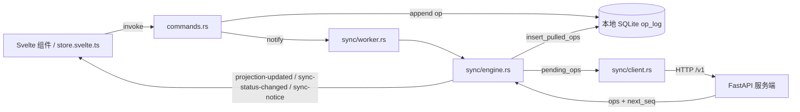

# Windows 客户端接入服务端同步

> 权威实现：`windows/src-tauri/src/sync/`。协议本身见 [`server-protocol.md`](./server-protocol.md)，本文只描述客户端如何落地。

## 一、总体结构



- 同步循环在 Rust 后台任务中运行，前端不直接发 HTTP。
- 领域层 `core_domain.rs` 与 IPC 类型不变；wire 转换只发生在 `sync/wire.rs`。
- 本地写入成功后通过 `Notify` 立即唤醒一次同步；正常轮询间隔取 `Settings.sync_interval`（最小 1 分钟）。

## 二、模块

| 文件 | 职责 |
| --- | --- |
| `sync/wire.rs` | `Op`（camelCase、扁平 HLC）与 wire（snake_case、嵌套 `hlc`、`source_meta`）双向映射；错误信封类型 |
| `sync/client.rs` | reqwest 客户端：register/login/refresh/logout/push/pull/members/invite/role/remove；统一 `ApiError`；`normalize_base` 容忍尾部 `/` 与 `/v1` |
| `sync/session.rs` | 账户快照（preferences `sync_account`）+ 令牌（Windows 凭据管理器，service `com.todo.windows.session`）；`TODO_SYNC_MEMORY_TOKENS=1` 时仅内存存储（测试用） |
| `sync/engine.rs` | push/pull 一轮、token 刷新、批量拆分、错误归类、HLC 校正、活动工作区兜底 |
| `sync/worker.rs` | 后台循环：Notify / 轮询间隔 / 指数退避（1→2→4…60s） |
| `sync/mod.rs` | `SyncState`、`SyncStateDto`、事件广播、通知去重 |
| `commands.rs` | 账户命令、`sync_now`、`sync_preflight`、清单/标签 CRUD、成员命令双模式 |

同步相关状态：

| 位置 | 内容 |
| --- | --- |
| `op_log.sync_state` | `pending` / `synced` / `rejected`；本地新建默认 `pending` |
| `op_log.server_seq` | 服务端确认后写入的全局序号 |
| `op_log.sync_error` | 被拒原因（`code: message`） |
| `meta.sync_cursor` | 已完整应用的 pull 游标 |
| `meta.sync_account` | `{serverUrl,userId,username,displayName}` JSON 快照 |
| `preferences.current_user_id` | 登录后等于服务端 `user_id` |
| `preferences.active_workspace_id` | 登录后切到服务端返回的工作区 |

`load_ops` 会过滤 `sync_state = 'rejected'`：被服务端拒绝的 op 保留在库中供导出，但不参与投影与历史。`load_all_ops` 包含被拒 op。

## 三、同步一轮

`engine::run_once` 先 push 后 pull，`tokio::sync::Mutex` 防重入。

### push

1. 取 `pending_ops`，每批最多 100 条，按 `created_at, rowid` 排序。
2. 发送 `POST /v1/sync/push`（顶层 `device_id` + `ops`）。
3. `accepted` / `duplicate` → 标记 `synced` 并写入 `server_seq`。
4. `rejected` → 标记 `rejected`，不自动重试；`workspace_access_revoked` / `forbidden` 生成红色提示，`hlc_too_far_ahead` 生成黄色提示。
5. 401 → 刷新 token 后重试一次；刷新失败进入 `auth_required`。
6. 413 → 批次减半重试；单条仍 413 时按 rejected 处理。
7. 整批 400/403 → 整批标记 rejected（服务端返回的 `results` 即使存在，也全部不可接受）。
8. 网络错误 / 5xx → 保留 pending，状态 `retrying`，由 worker 指数退避。

### pull

1. `GET /v1/sync/pull?since_seq=<cursor>&limit=200`，不带 `workspace_id`，一次拉取当前用户全部工作区。
2. 每页在单个 SQLite 事务内 `insert_pulled_ops` 并推进 `sync_cursor=next_seq`。
3. `server_hlc` 通过 `observe_hlc` 合并进本地 HLC（只前进，不回退）。
4. `has_more=true` 继续，单轮最多 20 页，避免长时间占用。
5. 拉取落库后修正 `active_workspace_id`：不存在则回落到投影中的第一个工作区。

## 四、账户生命周期

### 登录 / 注册

1. 调用 `/v1/auth/login` 或 `/v1/auth/register`。
2. 若本地 `sync_account` 与目标账户不同：
   - 用 `VACUUM INTO` 把整库备份到 `<data>\backups\todo-<时间戳>.sqlite3`；
   - 清空 `op_log` 与 `sync_*` meta；
   - 重置 `local_hlc` 的物理时间与计数器，保留 `node_id`。
3. 同一账户再次登录不清库，保留离线期间生成的 op 与游标。
4. 写入 `current_user_id`、`active_workspace_id`、`sync_account`，保存令牌。
5. 状态置为 `offline` 后立刻执行一次全量 pull（`since_seq=0` 或本地游标）。

`sync_preflight` 返回本地 op 总数与备份目录，设置页在有本地数据时要求二次确认。

### 登出

- 调用 `/v1/auth/logout`（失败忽略），清除凭据管理器令牌。
- 保留本地数据与 `sync_account`，状态 `signed_out`；同账户再次登录继续使用本地库。

### 令牌

- access/refresh token 只存 Windows 凭据管理器，不写 SQLite、日志或备份。
- 请求前 60 秒主动刷新；`invalid_refresh_token` 清除登录态并提示重新登录。
- refresh token 每次刷新都会轮换，客户端必须保存新值。

## 五、事件与 DTO

| 事件 | payload | 触发 |
| --- | --- | --- |
| `sync-status-changed` | `SyncStateDto` | 每轮同步开始/结束、登录、登出、手动同步 |
| `sync-notice` | `SyncNoticeDto` | 权限拒绝、时钟偏差、登录失效、op 级错误（按 `kind:code` 去重） |
| `projection-updated` | `{ workspaceId: string \| null }` | 拉取到新 op 或被拒 op 退出投影；工作区/成员变更用 `null` |

`SyncStateDto` 字段：`status`（`signed_out` / `syncing` / `synced` / `offline` / `retrying` / `auth_required`）、`account`、`pendingCount`、`rejectedCount`、`lastSyncedAt`、`lastError`、`cursor`。

`BootstrapResponse.sync` 携带同一 DTO，窗口首帧即可显示真实状态。

## 六、清单与标签

| 操作 | 命令 | 权限（服务端规则） |
| --- | --- | --- |
| 新建清单 | `create_list` | owner |
| 改名 / 改色 / 排序 | `update_list_field` | owner、editor |
| 删除清单 | `delete_list` | owner；`*-today` 智能清单禁删 |
| 新建标签 | `create_tag` | owner |
| 改名 / 改色 / 侧栏显示 | `update_tag_field` | owner、editor |
| 删除标签 | `delete_tag` | owner |

删除清单前会先把该清单下任务的 `list_id` 迁移到当前工作区的 `*-today` 智能清单，再写 `list.__deleted`。删除标签不清理任务上的 `tag_ids`，与共享 testvector 和服务端投影一致。

## 七、成员

- 已登录：邀请 / 改角色 / 移除分别调用 `POST /v1/workspace/invite`、`PATCH /v1/workspace/role`、`POST /v1/workspace/remove`，成功后立即 pull 一次。
- 未登录：保持本地 op 行为，用于单机模式。
- 邀请参数 `account` 优先取邮箱，其次取用户名；目标账号必须已注册。
- 服务端错误直接展示中文 `message`（`account_not_found`、`last_owner`、`cannot_remove_self`、`forbidden` 等）。

## 八、错误与提示

| 错误码 | UI |
| --- | --- |
| `workspace_access_revoked` / `forbidden` | 红色提示条「权限已变更，此操作未生效」，不自动重试 |
| `hlc_too_far_ahead` | 黄色提示条「本机时间偏差较大，已按服务器时间校正」 |
| `actor_mismatch` / `unauthorized` / `token_expired` | 红色提示条，状态转 `auth_required` |
| 其他 op 级错误 | 红色提示条（按 `kind:code` 去重） |
| 网络错误 / 5xx | 标题栏「重试中」，worker 指数退避 |

## 九、验证

```powershell
# 纯逻辑单测（不链接 Tauri）
cd windows\src-tauri
cargo test --lib --no-default-features

# 真实服务端端到端（自动起临时 uvicorn）
cd windows
npm run verify:sync
```

`tests/sync_e2e.rs` 覆盖：

1. 注册后首次全量拉取（种子工作区 + 4 清单 + 5 标签）。
2. 本地建任务 → push → 第二设备 pull 可见。
3. 双端并发改标题 → LWW 取 HLC 更大者。
4. 非成员推送 → 逐 op 拒绝、红色提示、被拒 op 不进投影。

## 十、已知服务端行为

- 重新邀请已移除成员只写 `__role`，不写 `__removed=false`，因此不要依赖「重新邀请恢复访问」。
- `workspace.__deleted` 不阻止 pull/push；客户端把已删工作区视为不可见并停止写入。
- `server_hlc` 不会因客户端 push 前进，只能 `max(local, server_hlc)`。
- 被拒 op 会在本地长期保留（含 `sync_error`），可通过 SQLite 导出排查。
- 每轮 refresh 仍会全量读取 op_log 重建投影；op 数量增长后需要增量投影优化。
