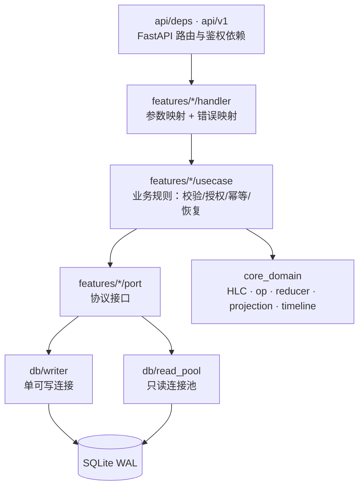

# 服务端设计文档（v1）

> 状态：待确认（确认后据此实现 `server/`）
> 协议细节见 [`docs/server-protocol.md`](./server-protocol.md)；工程规范以 [`docs/conventions.md`](./conventions.md) 为唯一权威。
> 架构决策来源：[`plans/todo-app-plan.md`](../plans/todo-app-plan.md) 第 2/4/8/9 节。

## 一、目标与非目标

### 1.1 目标

1. 为 Windows / Android 提供一个**只追加 op_log + 确定性投影**的同步服务，保证离线并发可收敛。
2. 服务端是**唯一授权入口**：任何写 op 都必须经过 Writer Worker 的角色裁决。
3. 与客户端 reducer **同构**：同一批 op 在 Python 与 Rust/Kotlin 侧投影结果一致（共享测试向量门禁）。
4. 支持：账号体系、增量推拉、工作区成员管理、历史时间线、快照、恢复到快照、工作区级备份导出。
5. 单机可运行（SQLite WAL），无外部依赖（不引入 Redis / PostgreSQL / 消息队列）。

### 1.2 非目标（本期不做）

- AI 推理、模型密钥、图片输入：全部在客户端，服务端不感知（`source` 只审计）。
- 附件 / 对象存储 / 断点续传。
- 邮件注册验证、找回密码、第三方登录。
- WebSocket / 服务端推送、实时在线状态。
- 多进程 / 多机部署（破坏「单可写连接」约束）。
- 工作区创建 / 重命名 / 删除的独立 REST 接口（走 op 管道）。
- Windows 首登的本地数据自动迁移（仅文档约定，列为后续迭代）。
- 客户端本地偏好（`active_workspace_id`、便利贴布局、`last_fired_at`、`snooze_until`）同步。

## 二、架构与依赖方向



硬约束（与 `conventions.md` 一/四节对应）：

- `core_domain` 不得 import `fastapi` / `aiosqlite` / `pydantic`；只接受纯数据结构，返回纯数据结构。
- `core_domain` 不得读取物理时钟：HLC 的 `physical_ms` 只能由调用方传入。
- `api/` 层不得获取可写数据库连接；所有写操作投递给 Writer Worker。
- 禁止 `services/` / `utils/` 横向层；每个功能一个目录，内含 `handler.py` / `usecase.py` / `port.py` / `schemas.py`。

## 三、模块目录

```text
server/
├── pyproject.toml                 # 依赖、ruff、pytest 配置
├── README.md                      # 启动、迁移、测试、冒烟、接口速查
├── .env.example                   # 全部配置项示例（不含真实密钥）
├── app/
│   ├── __init__.py
│   ├── main.py                    # create_app()、lifespan（迁移/Writer/读池）、异常处理器
│   ├── config.py                  # pydantic-settings，前缀 TODO_SERVER_
│   ├── services.py                # 组合根：settings + writer + read + 后台任务
│   ├── api/
│   │   ├── deps.py                # 解析 Bearer、当前用户、工作区成员校验
│   │   └── v1.py                  # 汇总各 slice 的 APIRouter
│   ├── core_domain/
│   │   ├── errors.py              # DomainError 层次（不依赖框架）
│   │   ├── hlc.py                 # Hlc、四元组全序、next_hlc
│   │   ├── op.py                  # Op 数据结构、字段白名单与值域校验（纯函数）
│   │   ├── reducer.py             # State：LWW 单元格 + OR-Set 元素
│   │   ├── projection.py          # WorkspaceProjection（lists/tags/members/tasks）
│   │   └── timeline.py            # 历史条目构建 + restore 差异意图
│   ├── db/
│   │   ├── migrations.py          # 迁移 runner（按版本号顺序、事务内应用）
│   │   ├── read_pool.py           # 只读连接池（query_only=ON）
│   │   ├── ops.py                 # op_log 读写、实体绑定、成员缓存、服务端 HLC
│   │   ├── writer.py              # WriterWorker：队列 + 事务 + seq + 缓存 + 快照触发
│   │   └── sql/
│   │       └── 0001_init.sql
│   ├── features/
│   │   ├── auth/                  # register/login/refresh/logout/me
│   │   ├── sync_push/             # 批内逐条校验、授权、幂等
│   │   ├── sync_pull/             # 游标增量查询
│   │   ├── workspace_member/      # 成员列表、邀请、改角色、移除
│   │   ├── history/               # timeline / snapshot / restore
│   │   ├── backup/                # 工作区导出、admin 全库快照
│   │   └── seed/                  # 注册种子 op（与服务端生成 op 共用工具）
│   └── infra/
│       ├── security.py            # Argon2id、JWT、令牌哈希与轮换
│       ├── clock.py               # 服务端时钟 + 服务端 HLC 推进（唯一读时钟处）
│       ├── logging.py             # 结构化日志，密钥脱敏
│       └── rate_limit.py          # 进程内滑动窗口
├── scripts/
│   └── smoke.py                   # 端到端冒烟（httpx）
└── tests/
    ├── conftest.py                # 临时库、app 工厂、已登录客户端夹具
    ├── test_auth.py
    ├── test_sync_push.py
    ├── test_sync_pull.py
    ├── test_authorization.py
    ├── test_idempotency.py
    ├── test_workspace_members.py
    ├── test_history_restore.py
    ├── test_backup.py
    ├── test_migrations.py
    └── test_core_domain.py        # 含 shared/testvectors 对拍与「不读时钟」检查
```

共享契约（三端复用）：

```text
shared/
├── protocol/
│   ├── op_envelope.schema.json
│   ├── push_request.schema.json
│   ├── push_response.schema.json
│   ├── pull_response.schema.json
│   └── error.schema.json
└── testvectors/
    ├── lww.json
    ├── orset_add_wins.json
    ├── subtask_fields.json
    ├── tag_association.json
    └── restore.json
```

## 四、数据模型

### 4.1 建表（`app/db/sql/0001_init.sql`）

`op_log` 的 `seq` 用 `INTEGER PRIMARY KEY AUTOINCREMENT`，天然单调、不复用；`op_id` 唯一索引承担幂等。

```sql
CREATE TABLE users (
  user_id        TEXT PRIMARY KEY,
  username       TEXT NOT NULL UNIQUE COLLATE NOCASE,
  email          TEXT UNIQUE COLLATE NOCASE,
  display_name   TEXT NOT NULL,
  password_hash  TEXT NOT NULL,
  created_at     INTEGER NOT NULL
);

CREATE TABLE refresh_tokens (
  token_id    TEXT PRIMARY KEY,
  family_id   TEXT NOT NULL,
  user_id     TEXT NOT NULL REFERENCES users(user_id),
  device_id   TEXT,
  token_hash  TEXT NOT NULL UNIQUE,
  issued_at   INTEGER NOT NULL,
  expires_at  INTEGER NOT NULL,
  used_at     INTEGER,
  revoked_at  INTEGER,
  replaced_by TEXT
);
CREATE INDEX idx_refresh_family ON refresh_tokens(user_id, family_id);

CREATE TABLE workspaces (
  workspace_id TEXT PRIMARY KEY,
  name         TEXT NOT NULL DEFAULT '',   -- 由 workspace.name op 维护的缓存
  deleted      INTEGER NOT NULL DEFAULT 0, -- 由 workspace.__deleted op 维护的缓存
  created_at   INTEGER NOT NULL
);

-- 成员当前态缓存：仅用于列表与快速判定；角色「时刻」判定以 op_log 为准。
CREATE TABLE memberships (
  workspace_id TEXT NOT NULL,
  user_id      TEXT NOT NULL,
  role         TEXT NOT NULL,
  removed      INTEGER NOT NULL DEFAULT 0,
  updated_at   INTEGER NOT NULL,
  PRIMARY KEY (workspace_id, user_id)
);

CREATE TABLE op_log (
  seq             INTEGER PRIMARY KEY AUTOINCREMENT,
  op_id           TEXT NOT NULL UNIQUE,
  workspace_id    TEXT NOT NULL,
  entity_type     TEXT NOT NULL,
  entity_id       TEXT NOT NULL,
  actor_id        TEXT NOT NULL,
  device_id       TEXT NOT NULL,
  operation       TEXT NOT NULL,
  field           TEXT NOT NULL,
  value_json      TEXT NOT NULL,
  physical_ms     INTEGER NOT NULL,
  counter         INTEGER NOT NULL,
  node_id         TEXT NOT NULL,
  source          TEXT NOT NULL,
  source_meta_json TEXT,
  received_at     INTEGER NOT NULL
);
CREATE INDEX idx_op_ws_seq   ON op_log(workspace_id, seq);
CREATE INDEX idx_op_entity   ON op_log(entity_type, entity_id, physical_ms, counter, node_id, op_id);
CREATE INDEX idx_op_ws_member ON op_log(workspace_id, entity_type, entity_id);

-- 实体 → 工作区绑定，首次写入固定，禁止跨工作区迁移。
CREATE TABLE entities (
  entity_type TEXT NOT NULL,
  entity_id   TEXT NOT NULL,
  workspace_id TEXT NOT NULL,
  created_seq INTEGER NOT NULL,
  PRIMARY KEY (entity_type, entity_id)
);
CREATE INDEX idx_entities_ws ON entities(workspace_id, entity_type);

CREATE TABLE snapshots (
  snapshot_id     TEXT PRIMARY KEY,
  workspace_id    TEXT NOT NULL,
  seq             INTEGER NOT NULL,
  projection_json TEXT NOT NULL,
  created_at      INTEGER NOT NULL
);
CREATE INDEX idx_snapshots_ws_seq ON snapshots(workspace_id, seq);

-- 服务端 HLC（node_id 固定 "srv"）；单行。
CREATE TABLE server_hlc (
  id          INTEGER PRIMARY KEY CHECK (id = 1),
  physical_ms INTEGER NOT NULL,
  counter     INTEGER NOT NULL,
  node_id     TEXT NOT NULL
);

CREATE TABLE schema_migrations (
  version    INTEGER PRIMARY KEY,
  name       TEXT NOT NULL,
  applied_at INTEGER NOT NULL
);
```

### 4.2 索引与查询要点

| 场景 | 查询 | 依赖索引 |
| --- | --- | --- |
| 幂等判定 | `SELECT seq FROM op_log WHERE op_id = ?` | `op_log.op_id` UNIQUE |
| 增量拉取 | `SELECT ... WHERE workspace_id = ? AND seq > ? ORDER BY seq LIMIT ?` | `idx_op_ws_seq` |
| 全工作区拉取 | 同上但省略 `workspace_id`，需 JOIN `memberships` 过滤 | `idx_op_ws_seq` + `memberships` 主键 |
| 角色时刻判定 | `WHERE entity_type='membership' AND entity_id=? AND (physical_ms, counter, node_id, op_id) <= (?,?,?,?) ORDER BY physical_ms DESC, counter DESC, node_id DESC, op_id DESC` | `idx_op_entity` |
| 实体绑定 | `SELECT workspace_id FROM entities WHERE entity_type=? AND entity_id=?` | `entities` 主键 |
| 快照回放 | `WHERE workspace_id = ? AND seq <= ? ORDER BY seq` | `idx_op_ws_seq` |
| 时间线 | `WHERE workspace_id = ? [AND entity_id = ?] AND seq < ? ORDER BY seq DESC LIMIT ?` | `idx_op_ws_seq` |

### 4.3 数据约定

- `value_json` 存原始 JSON（`json.dumps(..., ensure_ascii=False, separators=(",",":"))`），不做业务改写。
- `source_meta_json` 为 `null` 或 `{"model": ..., "prompt_hash": ...}`。
- 服务端生成 op 的 `node_id = "srv"`；客户端生成的 `node_id` 由客户端设备决定。
- **不做物理删除**：工作区删除是 `__deleted = true` 墓碑；`op_log`、`entities`、`snapshots` 永不删除。

## 五、Writer Worker 与并发模型

### 5.1 结构

- 进程内**唯一** `aiosqlite` 可写连接，由一个常驻 `asyncio.Task` 独占。
- `WriterWorker.submit(txn: Callable[[aiosqlite.Connection], Awaitable[T]]) -> T`：
  1. 把 `(txn, future)` 放进 `asyncio.Queue`；
  2. 常驻任务取出后执行 `BEGIN IMMEDIATE` → `txn(conn)` → `COMMIT`；异常则 `ROLLBACK` 并 `future.set_exception`；
  3. 队列串行化保证无并发写，`busy_timeout = 5000` 兜底外部工具占用。
- 读路径：`ReadPool`（默认 4 条连接），每条 `PRAGMA query_only = ON`、`journal_mode = WAL`。读连接**不参与**写事务。

### 5.2 一次 push 的事务边界

- **整批一次事务**（最大 500 条）：单条 `rejected` 只是不写入，同批其余 op 照常提交；事务级异常（磁盘、锁超时等）整体回滚。
- 幂等、校验、授权全部在事务内完成，避免「校验时是成员、写入时已被移除」的竞态。
- 事务内顺序：逐条 op 校验 → 授权 → `INSERT op_log` 取 `seq` → 更新 `entities` / `memberships` 缓存。
- 事务外：返回结果、触发快照检查、写日志。

### 5.3 seq 与水位

- `seq` 由 `AUTOINCREMENT` 分配；`server_seq` = `SELECT MAX(seq) FROM op_log`（读连接）。
- `pull` 允许「读已提交」的弱一致：可能在 push 提交前读到旧水位，客户端下一轮自然补齐。

### 5.4 单进程约束

- 启动时对 `<db_path>.lock` 取独占锁（Windows `msvcrt.locking` / POSIX `fcntl.flock`）；失败则**拒绝启动**并提示「服务端只支持单进程运行」。
- 文档与 README 均要求 `--workers 1`。

## 六、授权算法

### 6.1 判定步骤（sync_push/usecase）

1. **身份**：`op.actor_id == token.user_id`，否则 `actor_mismatch`。
2. **绑定**：查 `entities`；
   - 已绑定且 `workspace_id` 不一致 → `entity_workspace_mismatch`；
   - 未绑定：`workspace` / `membership` 按 `entity_id` 解析；其余实体要求 `field == "__created"`，随后写入绑定（`created_seq = 本次分到的 seq`）。
3. **工作区存在**：`workspaces` 表 + `memberships` 缓存双重校验；不存在 → `workspace_not_found`。
4. **角色时刻**：`resolve_role_at(conn, workspace_id, actor_id, op_key)`：
   - 取该成员全部 `membership` op（`__role` / `__removed`），按四元组 ≤ `op_key` 过滤；
   - `role` = 最新 `__role` 值；`removed` = 最新 `__removed` 值；
   - `removed = true` 或无 `__role` → `None`（`workspace_access_revoked`）。
   - 同一批内按 `(workspace_id, user_id)` 记忆化，避免逐条重复查询。
5. **矩阵判定**（协议第八节）：不满足 → `forbidden`；`None` → `workspace_access_revoked`。

### 6.2 特殊规则

| 规则 | 说明 |
| --- | --- |
| 最后一个 owner | `membership.__role != owner` 或 `__removed = true` 时，若该工作区有效 owner 数将降为 0 → 拒绝（`last_owner`） |
| owner 移除自己 | 允许的前提是另有 owner，否则 `last_owner`；客户端另有 `cannot_remove_self` 提示 |
| `user.*` 目标 | 目标为自己：任何角色可写自己的资料；目标为他人：仅 owner |
| `list_id` | 必须是同工作区已存在的 list（`entities` 查询）；不存在 → `unknown_list` |
| 服务端生成 op | 跳过 `actor_id` 校验，但仍按矩阵校验调用者角色（邀请/改角色必须 owner） |
| 读接口 | 只校验成员关系 + `removed = false`；不做写权限判断 |

### 6.3 与客户端的边界

- 客户端本地命令层的前置校验（例如 `ensure_workspace_owner`）只是体验优化。
- 客户端不得缓存「我有权限」的结论；被拒后按 `workspace_access_revoked` 终态处理，并刷新成员投影。

## 七、HLC 与时钟

- 服务端 HLC：`node_id = "srv"`，持久化在 `server_hlc` 单行；每次生成 op 时：
  `physical_ms = max(now_ms, prev.physical_ms)`，若 `now_ms > prev.physical_ms` 则 `counter = 0`，否则 `counter = prev.counter + 1`。
- 生成 op 的 HLC 还需保证能压过工作区已有 op（否则恢复/改角色可能被「超前 4 分钟」的客户端 op 覆盖）：
  `physical_ms = max(now_ms, max_physical_ms_of_workspace)`，`counter` 在该物理毫秒上递增。
- 客户端 op 的时钟校验：`physical_ms > now + HLC_MAX_FUTURE_MS` 拒绝（`hlc_too_far_ahead`），允许任意历史时间。
- 拒绝时响应携带 `server_hlc`，客户端据此推进本地 `local_hlc`，不改写已生成 op。
- `core_domain` 只接收 `physical_ms` 参数；`infra/clock.py` 是唯一调用 `time.time()` 的模块（CI 静态检查）。

## 八、投影与三端一致性

### 8.1 reducer 语义（与 Windows `core_domain.rs` 逐条对齐）

| Windows 实现 | Python 对应 |
| --- | --- |
| `State::apply` 排序 `(hlc, op_id)` | `State.apply_all(ops)` 先按 `(physical_ms, counter, node_id, op_id)` 排序 |
| `Cell` 替换条件 `(hlc, op_id) > (existing.hlc, existing.op_id)` | 同 |
| `ElementState.alive()`：`add >= remove` | 同，比较四元组 |
| `__created` 决定实体 `source` / `model` 元信息 | 同 |
| 任务按 `status`（done 后置）+ `order` + `id` 排序 | 同 |
| 成员排序：自己置顶 → 角色 → 名称 | 同 |
| 清单 `smart = id == "today" or id.endswith("-today")` | 同 |
| 子任务排序 `(order, id)` | 同 |

### 8.2 一致性的强制手段

- `shared/testvectors/*.json`：每份向量 = `{name, ops[], expect:{fields|collections|projection}}`。
- `tests/test_core_domain.py` 读取全部向量并断言；Rust/Kotlin 后续接同一批文件。
- 另加 property-based 断言（`hypothesis`）：
  - 收敛性：任意排列 ops → 投影相同；
  - 幂等性：重复 op → 投影相同；
  - 平局确定性：交换两端 op 顺序 → 结果不变。
- CI 门禁：`ruff` 规则 + 自定义 AST 测试禁止 `core_domain` 出现 `time.`、`datetime.now`、`datetime.utcnow`、`fastapi`、`aiosqlite`。

### 8.3 投影产物（快照 / 备份使用）

```text
WorkspaceProjection {
  workspace_id, lists[], tags[], members[], tasks[]
}
```

字段见协议 9.3；`lists[]` 额外带 `order` 供恢复差异比对；`tasks[].tag_ids` 与客户端一致，不按标签删除过滤。服务端不输出 `history` / `active_workspace_id` / `current_user_id`（这些是客户端视图态）。

## 九、快照与恢复

### 9.1 自动快照

- Writer 在每次 push 提交后，读取该工作区「最新快照 seq 之后的 op 数」；达到 `SNAPSHOT_EVERY_OPS`（默认 500，0 = 关闭）则提交一个快照任务。
- 快照任务：回放该工作区 `seq <= target` 的 op → 序列化投影 → `INSERT snapshots`；`target` 取当前最大 seq。
- 回放成本：单工作区 10 万 op 量级在秒级完成；超出则先分页回放并在 README 标注容量建议。

### 9.2 恢复算法（`features/history/usecase.restore`）

伪流程（全部在 Writer 事务内执行，保证与并发 push 串行）：

1. 读取快照投影 `S`（`snapshot_id` 必须属于该工作区）。
2. 回放该工作区全部 op（或从快照 seq 起再叠加），得到当前投影 `C`。
3. `core_domain.timeline.diff_projections(target=S, current=C, allow_delete=False)` 生成意图列表：
   - 实体存在性：`S` 有且 `C` 已删除 → `set __deleted = false`；
   - 标量字段：逐字段比较规范化 JSON，不同则 `set field = S 值`；
   - 标签集合：`S.tag_ids - C.tag_ids` → `add __tag`；反向 → `remove __tag`；
   - 子任务集合：差集 → `add/remove __subtask`；新增子任务的 `text/done/order` 一并 `set`；
   - 不生成 `__created`；不处理 `membership` / `workspace` / `user`。
4. 意图数 > 5000 → `restore_too_large`，整事务回滚。
5. `dry_run = true`：只返回 `changes`，不写库。
6. 写入：每条意图分配服务端 HLC（见第七节），`actor_id = 调用者`，`source = "human"`，走与 push 相同的字段校验与授权矩阵。
7. 响应 `changes` 与 `op_count`；不写 `__undo_of`（恢复不是对单条 op 的撤销）。

### 9.3 时间线

- `core_domain.timeline.build_timeline(ops, workspace_id, task_id, before_seq, limit, now_ms)`：
  - 按 HLC 排序累积 `last_values`，得到每条 op 的旧值；
  - 生成 `action` 文案（与客户端 `action_of` 同表）；
  - 标记 `undone`（存在 `task.__undo_of = op_id`）与 `undoable`；
  - 输出按 `at_ms` 降序、`op_id` 降序。
- 时间线只读、只走读连接；不产生 op。

## 十、备份

### 10.1 工作区导出

1. `PRAGMA wal_checkpoint(TRUNCATE)`（由 Writer 执行，避免与写事务冲突）。
2. 读连接读取该工作区 `op_log`（按 `seq`）与最新快照/实时投影。
3. 生成 zip：`manifest.json` + `workspace/ops.jsonl` + `workspace/projection.json`，落临时文件后流式返回。
4. 字段白名单输出：**不包含** `users.password_hash`、`refresh_tokens`、JWT 密钥、其他工作区数据、客户端偏好。

### 10.2 admin 全库快照

- `X-Admin-Token` 与环境变量常量时间比较；未配置时路由返回 404（不暴露存在性）。
- WAL checkpoint 后复制 `server.sqlite3` 到 `BACKUP_DIR/server-<yyyymmddHHMMSS>.sqlite3`，并附 `ops.jsonl` 全量逻辑导出。
- 备份文件权限：仅服务账号可读；README 提示备份包含用户口令哈希，需按敏感数据处理（导出时可选 `--exclude-users`，本期不做）。

## 十一、配置项

| 环境变量 | 默认值 | 说明 |
| --- | --- | --- |
| `TODO_SERVER_DB_PATH` | `./data/server.sqlite3` | SQLite 文件路径（目录自动创建） |
| `TODO_SERVER_JWT_SECRET` | 无（必填） | HS256 签名密钥，≥32 字节 |
| `TODO_SERVER_ADMIN_TOKEN` | 空 | `/v1/admin/backup` 令牌；空 = 关闭该接口 |
| `TODO_SERVER_ACCESS_TTL_MINUTES` | `30` | 访问令牌有效期 |
| `TODO_SERVER_REFRESH_TTL_DAYS` | `30` | 刷新令牌有效期 |
| `TODO_SERVER_MAX_OPS_PER_PUSH` | `500` | 单次 push 上限 |
| `TODO_SERVER_MAX_BODY_BYTES` | `1048576` | 请求体上限 |
| `TODO_SERVER_HLC_MAX_FUTURE_MS` | `300000` | 时钟超前阈值 |
| `TODO_SERVER_SNAPSHOT_EVERY_OPS` | `500` | 自动快照间隔；0 = 关闭 |
| `TODO_SERVER_DEFAULT_WORKSPACE_NAME` | `我的空间` | 注册默认工作区名 |
| `TODO_SERVER_BACKUP_DIR` | `./data/backups` | admin 备份目录 |
| `TODO_SERVER_AUTH_RATE_LIMIT` | `10` | 每分钟每 IP 的鉴权请求上限；0 = 关闭 |
| `TODO_SERVER_LOG_LEVEL` | `info` | 日志级别 |
| `TODO_SERVER_BIND_HOST` / `PORT` | `127.0.0.1` / `8000` | 仅用于 README 与 `python -m app` 便捷启动 |

配置由 `pydantic-settings` 加载，`.env` 可选；启动时校验密钥长度与目录可写性，失败即退出并打印中文原因。

## 十二、安全

| 面向 | 措施 |
| --- | --- |
| 口令 | Argon2id（`time_cost=3, memory_cost=65536, parallelism=4`），最大长度 128，禁止明文入日志 |
| 刷新令牌 | 32 字节随机（`secrets.token_urlsafe`），仅存 SHA-256；轮换 + 家族复用检测（复用 → 吊销整族） |
| 访问令牌 | JWT HS256，`sub` / `exp` / `iat` / `jti` / `typ=access`；不存任何敏感信息 |
| 越权 | `actor_id == token.sub`；工作区绑定 + role-at-HLC；服务端生成 op 也走矩阵 |
| 注入 | 全部 SQL 参数化；`value_json` 只做 JSON 解析与类型校验，不拼接 |
| 载荷 | 请求体大小中间件 + 批量上限 + 字段长度上限 |
| 限流 | 鉴权重试暴力破解：进程内滑动窗口 10/min/IP |
| 传输 | 默认 `127.0.0.1`；公网部署要求反向代理 TLS（README 说明，不做内建 TLS） |
| 日志 | 令牌、口令、`Authorization` 头统一脱敏；错误日志只记录 `code` 与 `op_id` |
| 备份 | 排除密钥；admin 备份提示含口令哈希 |
| CORS | 默认不启用（桌面/移动客户端不需要）；如需浏览器调试由环境变量显式开启 |

## 十三、日志与可观测

- 结构化 JSON 日志（`uvicorn` access log 保留）：`ts` / `level` / `event` / `request_id` / `user_id` / `workspace_id` / `op_count` / `accepted` / `rejected` / `duration_ms`。
- 关键事件：`push.committed`、`push.partial_reject`、`push.all_rejected`、`pull.page`、`auth.login_failed`、`auth.refresh_reuse_detected`、`history.restore`、`snapshot.created`、`backup.exported`。
- `GET /v1/health` 暴露 `db_seq`、`writer_queue_depth`、`server_hlc` 供探活。
- 不做 metrics/Prometheus 端点（本期非目标）。

## 十四、测试策略

| 层 | 内容 |
| --- | --- |
| `core_domain` | `shared/testvectors` 全量对拍；LWW 平局、OR-Set add-wins、子任务字段、标签关联、墓碑与字段并发；hypothesis 收敛/幂等/交换律 |
| Writer | 幂等（重复 `op_id` 不产生第二行、返回原 `seq`）；整批回滚（第 N 条非法时前 N-1 条不落库）；`seq` 单调 |
| 授权 | owner/editor/viewer × 字段矩阵；role-at-HLC（降权前 op 通过、降权后 op 拒绝）；移除后 `workspace_access_revoked`；`actor_mismatch`；实体跨工作区 `entity_workspace_mismatch` |
| 时钟 | 超前 5 分钟拒绝并回传 `server_hlc`；历史时间接受 |
| 迁移 | 从版本 0/1/2… 依次升级到最新；重复执行幂等；失败回滚 |
| 历史 | timeline 排序/旧值/撤销标记；snapshot 计数；restore dry_run 不写库；restore 后投影等于快照；restore 不删除新实体 |
| 备份 | zip 结构；不含 `password_hash` / `refresh_token`；ops.jsonl 行数与 DB 一致 |
| API | httpx `AsyncClient` + 临时库全链路：注册→登录→push→pull→冲突合并→成员→快照→恢复→导出 |
| 冒烟 | `scripts/smoke.py` 对真实 uvicorn 进程执行上述链路并断言 |

覆盖率目标：`app/core_domain` ≥ 90%，其余 ≥ 80%（`pytest-cov`）；CI 跑 `ruff check` + `ruff format --check` + `pytest`。

## 十五、部署与运维

```powershell
cd server
py -3.12 -m venv .venv
.\.venv\Scripts\Activate.ps1
pip install -e ".[dev]"
$env:TODO_SERVER_JWT_SECRET = "<32 字节以上随机串>"
uvicorn app.main:app --host 127.0.0.1 --port 8000 --workers 1
```

- 启动顺序：加载配置 → 取单进程锁 → 运行迁移 → 初始化 `server_hlc` → 启动 Writer → 启动读池 → 就绪。
- 优雅关闭：停止接收请求 → 等待 Writer 队列清空（上限 10s）→ 关闭连接 → 释放锁。
- 升级：替换代码后重启；迁移在启动时自动执行；`op_log` 只增不删，回滚需用旧二进制 + 兼容 schema（README 标注「迁移单向」）。
- 容量建议：单工作区 10 万 op 以内、总库 < 2 GB 时单机 SQLite 足够；超出先加自动快照并归档旧快照。

## 十六、客户端接入（本期仅文档）

Windows 端需要的改动（后续迭代，不在本次范围）：

1. `windows/src-tauri/src/sync/`：push/pull 循环、退避、令牌刷新、`REJECTED` 终态标记。
2. 凭据管理：access/refresh token 存 Windows Credential Manager；`Settings.server_url` / `sync_interval` 已存在，直接复用。
3. 身份绑定：登录后 `current_user_id` 切为服务端 `user_id`；本地 `ws-me` 种子在「已登录」模式下不再生成。
4. 首登数据：要求空库或仅种子；已有业务 op 的迁移（整工作区推送）列为后续需求。
5. UI：同步状态四态（已同步/同步中/离线/重试中）、403 红条、时钟黄条，均为现有文档已定义的文案。

## 十七、范围边界与已知取舍

1. **只做轮询**：最坏延迟 = `sync_interval`（默认 5 分钟）；Android 下拉刷新与前台唤醒可即时触发 pull。
2. **单进程**：换取「唯一可写连接」的强约束与零外部依赖；水平扩展需改为 PostgreSQL + 单写入服务，超出本期。
3. **恢复不删除新实体**：避免「恢复一次快照就吞掉后续一周工作」的破坏性语义；如需完全回滚，走备份恢复流程。
4. **工作区创建走 op**：与客户端 `create_workspace` 的预设一致性文案保持单一实现；服务端只在注册时种子一次。
5. **权限 op 与业务 op 同管道**：离线端重连可拉到降权/移除，代价是每次写 op 需要 role-at-HLC 查询（已用索引 + 批内记忆化控制）。
6. **不校验 `node_id == device_id`**：客户端种子数据的 `node_id` 与 `device_id` 前缀规则不同；服务端只做长度与连续性约束。
