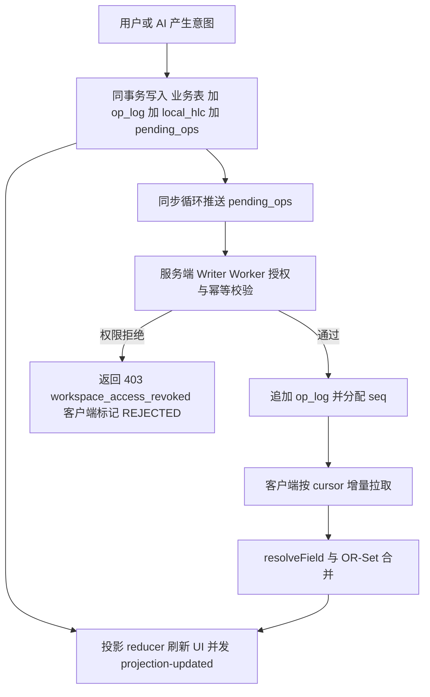

# 待办事项 App 三端架构计划（定稿）

工程规范以 [`docs/conventions.md`](../docs/conventions.md) 为唯一权威来源，本文件只做架构决策汇总。

## 1. 技术栈

| 端 | 选型 |
| --- | --- |
| Windows | Tauri 2 + Rust 后端 + Svelte 5 + Vite，通知用 `tauri-plugin-notifications`，打包用 Tauri bundler |
| Android | Kotlin + Jetpack Compose + Room |
| 服务端 | Python + FastAPI 全异步 + aiosqlite + SQLite WAL |
| 客户端存储 | SQLite |
| 鉴权 | 用户名密码 + JWT 访问/刷新令牌，Argon2id |

> 早期讨论的 WinUI 3 / windows-rs 方案已废弃，以 Tauri 2 为准。

## 2. 数据层核心

- 状态不落库为真相，由 `op_log` 确定性投影得出，日志只追加。
- op 信封按「字段」或「集合元素」表达，携带 `operation ∈ {set, add, remove}`。
- 合并原语只有两种：`resolveField` 的 LWW、集合关联的 OR-Set，禁止为功能追加特例分支。

### 2.1 op 信封

```json
{
  "op_id": "uuid",
  "workspace_id": "ws-uuid",
  "entity_type": "task",
  "entity_id": "task-uuid",
  "actor_id": "user-uuid",
  "device_id": "设备ID",
  "operation": "set",
  "field": "title",
  "value": "买牛奶",
  "hlc": { "physical_ms": 1762528000000, "counter": 3, "node_id": "win-7f3a" },
  "source": "human",
  "source_meta": { "model": null, "prompt_hash": null }
}
```

- `source ∈ {human, ai, import}`，仅用于本地审计，不参与裁决，服务端不得据此做安全判断。
- `workspace_id` 是隔离键；`actor_id` 用于权限校验与历史归属。

### 2.2 裁决规则

- 字段单元格：取 `(hlc.physical_ms, hlc.counter, node_id, op_id)` 最大者，全序确定性。
- 集合关联（标签、子任务）：OR-Set，add-wins。
- 子任务字段复用命名约定 `__subtask:<subtask_id>:<field>`，不新增合并逻辑。
- 排序用 fractional indexing，并发冲突按 `(order, 元素ID)` 平局裁决。
- `last_fired_at`、`snooze_until`、便利贴窗口布局为本地态，不进 `op_log`。

### 2.3 游标与同步

- 服务端为每条 op 分配全局单调 `seq`。
- 拉取按 `workspace_id` 过滤、`seq > cursor` 增量。
- `seq` 只表达交付顺序，因果与冲突一律由 HLC 决定。
- 时钟漂移：op 的 `physical_ms` 超出服务端阈值则拒绝并回传 `server_hlc` 供校正。



## 3. 实体与字段

| 实体 | 字段 |
| --- | --- |
| `list` | `__created` `__deleted` `name` `color` `order` `workspace_id` |
| `task` | `__created` `__deleted` `title` `notes` `due_at` `priority` `status` `list_id` `remind_at` `order`，集合 `__tag`、`__subtask` |
| `tag` | `__created` `__deleted` `name` `color` |
| `membership` | `__role`（owner/editor/viewer）`__removed` |
| 子任务单元格 | `__subtask:<subtask_id>:text` / `:done` / `:order` |

- 子任务只有 `text`、`done`、`order`，需要更多能力就「提升为任务」。
- 标签与任务用 `task_tag` 关联表 + `__tag` OR-Set，禁止在 `task` 上放数组列。
- 工作区在注册时自动创建并写 `membership` op，与业务 op 同管道。

## 4. 服务端

- 分层：`api/v1 → 纵向功能切片 → core-domain / db`，只有 Writer Worker 持可写连接。
- 功能切片：`auth`、`workspace-member`、`sync-push`、`sync-pull`、`history`、`backup`。
- 授权唯一入口：Writer Worker 追加前，由 `entity_id` 反查 `workspace_id`，取该 op HLC 时刻成员角色，按权限矩阵判定。
- 接口：`/v1/auth/{register,login,refresh,logout}`、`/v1/sync/push`、`/v1/sync/pull`、`/v1/history/{timeline,snapshot,restore}`、`/v1/workspace/{members,invite,role,remove}`、`/v1/backup/export`。
- 备份：WAL checkpoint 后单文件拷贝 + 逻辑导出，排除任何密钥。

## 5. Windows 端

```
windows/
├── src-tauri/src/
│   ├── core-domain/       纯 HLC op LWW OR-Set reducer
│   ├── storage-sqlite/    oplog pending_ops projection 本地偏好 迁移
│   ├── sync/              推拉循环 退避 令牌刷新
│   ├── ai/                意图 schema 校验 模型调用 撤销
│   ├── reminder/          托盘计时循环 通知 补发
│   └── commands/          task rs / sync rs / history rs / sticky rs
└── ui/
    ├── index.html
    ├── sticky.html        便利贴独立入口
    └── src/views/         tasks/ history/ sticky-note/ settings/
```

- Svelte 5 Runes 管理状态，Rust 是投影唯一真相源，前端不持久化业务数据。
- 用 `tauri-specta` 生成 `ipc-bindings.generated.ts` 并入 git，CI 校验生成结果无 diff。
- 密钥存 Windows Credential Manager（DPAPI），禁止落入 SQLite、日志、备份。

## 6. Android 端

```
android/
├── core/domain/    与 Rust 同构的 HLC op reducer
├── core/data/      Room oplog pending_ops projection 本地表
├── core/network/   Retrofit TokenAuthenticator Keystore
├── core/sync/      WorkManager 周期同步 前台即时同步
├── core/ai/        意图 schema 校验 模型调用
├── feature/tasks/ feature/history/ feature/settings/
└── app/
```

- 提醒用 `USE_EXACT_ALARM` + `setAlarmClock()`，唯一 data URI 的 `PendingIntent`，`BOOT_COMPLETED` 重建。
- 令牌 Keystore 加密后存 DataStore；AI 密钥禁入 SQLite。

## 7. AI 本地接入

- AI 在客户端运行，产物是普通 op，`source="ai"`，不参与裁决。
- 服务端无 AI 切片、无模型密钥、不感知来源。
- 输出必须过意图 schema 校验；批量超阈值需确认摘要；撤销靠更高 HLC 的反向 op。
- 支持文本与图片两种输入。图片仅发送至用户自配的模型端点，不入 `op_log`、不持久化为任务附件、不同步；解析失败不落盘、不生成 op。

## 8. 三端一致性保障

- `shared/protocol/`：op 与接口 JSON Schema。
- `shared/testvectors/`：LWW、OR-Set、子任务六类、标签五类、提醒两类、权限撤回、恢复、快照兜底。
- Rust / Kotlin / Python 三份实现跑同一批向量，含 property-based 收敛性与幂等性断言。

## 9. 风险与对策

| 风险 | 对策 |
| --- | --- |
| 三端 reducer 漂移导致数据分叉 | 共享向量 + 三端一致性 CI 强制门禁 |
| 权限裁决依赖 HLC 时刻角色，回放成本 | `op_log` 按 `entity_id` 建索引，角色查询限定在 membership 子集 |
| 日志无限增长 | 快照 + 归档策略，协议层预留快照标记 |
| SQLite 单写入者瓶颈 | 短事务、批量聚合、读走独立连接、WAL |
| Tauri 多窗口内存占用 | 便利贴走独立轻量入口，上限 5 个，不加载主 UI |
| 时钟篡改 | HLC 只做单调合并，服务端阈值拒绝并回传 `server_hlc` |

## 10. 文档索引

- [`docs/conventions.md`](../docs/conventions.md) 工程规范（唯一权威）
- [`docs/collaboration-model.md`](../docs/collaboration-model.md) 协作与权限
- [`docs/subtask-model.md`](../docs/subtask-model.md) 子任务建模
- [`docs/reminder-and-tag-model.md`](../docs/reminder-and-tag-model.md) 提醒与标签
- [`docs/ai-local-integration.md`](../docs/ai-local-integration.md) AI 本地接入
- [`docs/windows-frontend-spec.md`](../docs/windows-frontend-spec.md) Windows 前端与 IPC
- [`docs/sticky-note-spec.md`](../docs/sticky-note-spec.md) 便利贴
