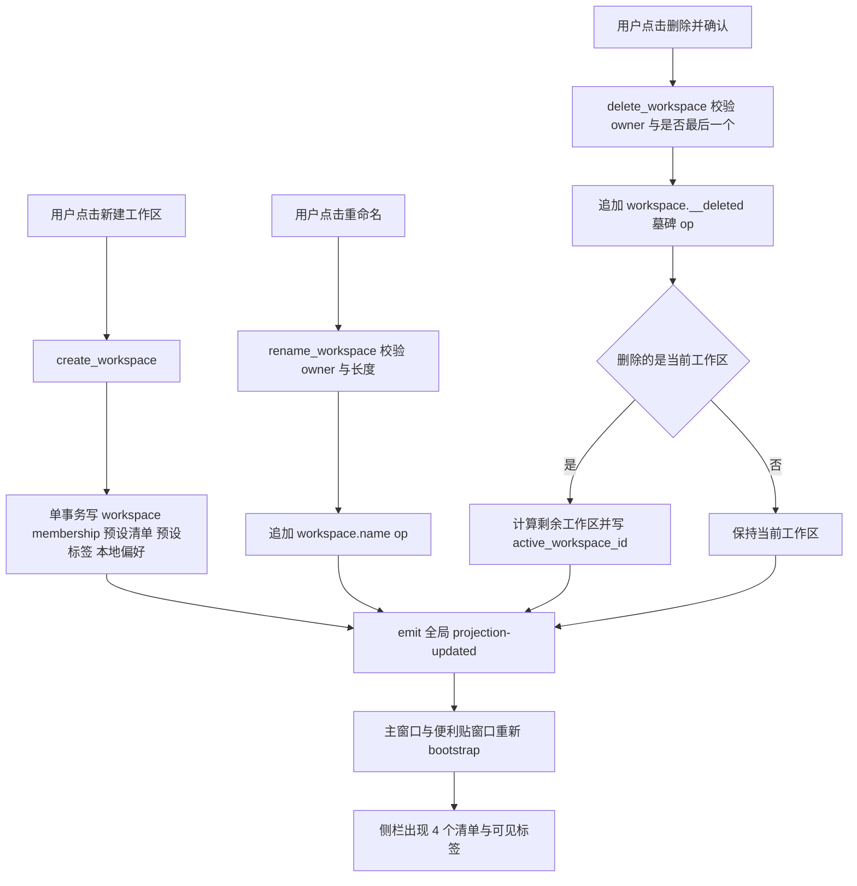
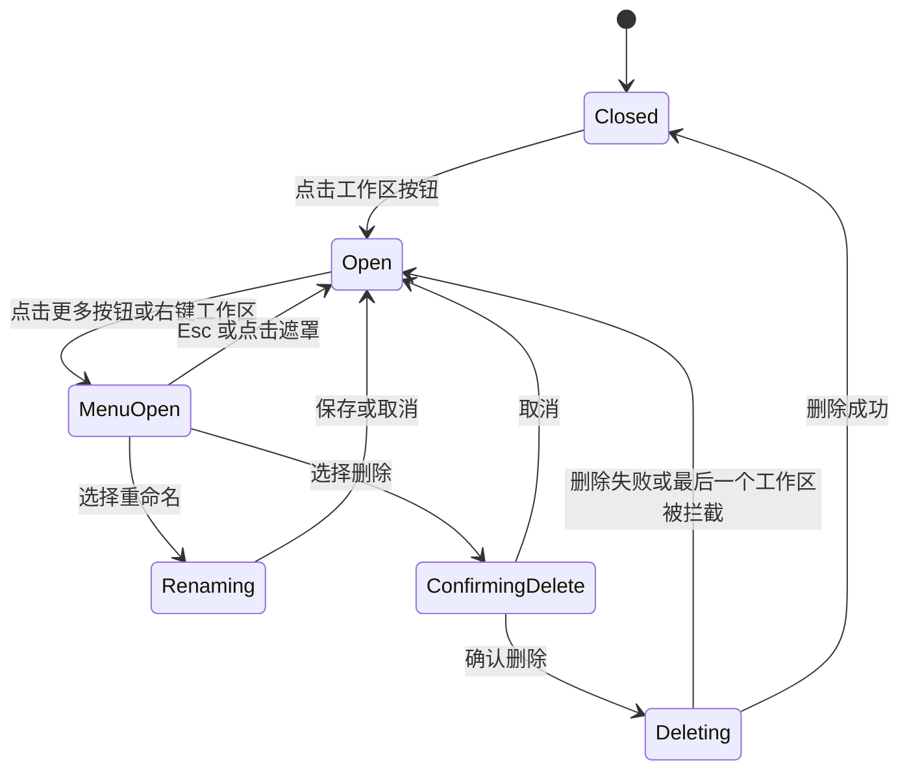

# 工作区预设与生命周期管理 实施计划

> 状态：已确认，已实施
> 范围：Windows 端 Tauri + Svelte 实现；不改动 Android / 服务端代码，但同步更新共享文档口径。
> 关联文档：[`docs/collaboration-model.md`](../docs/collaboration-model.md:41)、[`docs/ui-implementation-spec.md`](../docs/ui-implementation-spec.md:221)、[`docs/ui-delivery-checklist.md`](../docs/ui-delivery-checklist.md:73)

## 一、问题与现状证据

### 1.1 新建工作区后清单与标签不符合预期

当前 [`create_workspace()`](../windows/src-tauri/src/commands.rs:192) 只写入：

- 1 条 `workspace` 的 `__created` 与 `name` op
- 1 条 `membership.__role = owner` op
- 仅 1 个清单 `<workspace_id>-today`（名称「今天」）

没有写入任何 `tag` op，也没有写入「工作」「生活」「学习」清单。因此新工作区在侧栏中只有一个「今天」，标签区完全空白；与首次启动的默认工作区（[`seed_if_empty()`](../windows/src-tauri/src/storage.rs:379) 写入 4 个清单 + 5 个标签）不一致。

浏览器预览同样存在不一致：[`applyBrowserWorkspace()`](../windows/src/lib/store.svelte.ts:448) 对非 `ws-me` 工作区只给 1 个「今天」清单且标签为空。

### 1.2 重命名能力后端已有，前端未暴露

- IPC 封装已存在 [`renameWorkspace()`](../windows/src/lib/ipc.ts:39)
- Rust 命令已存在 [`rename_workspace()`](../windows/src-tauri/src/commands.rs:250)
- Store 方法已存在 [`renameWorkspace()`](../windows/src/lib/store.svelte.ts:487)
- 但 [`WorkspaceSwitcher.svelte`](../windows/src/components/WorkspaceSwitcher.svelte:67) 的工作区列表项只支持「切换」，没有任何重命名入口。

### 1.3 删除工作区完全缺失

- `lib.rs` 的 `invoke_handler` 未注册删除命令（[`lib.rs`](../windows/src-tauri/src/lib.rs:117)）
- `ipc.ts` 无删除封装
- Store 无删除方法
- UI 无删除入口
- 投影层已具备墓碑语义：工作区列表会过滤 `state.deleted("workspace", id)`（[`core_domain.rs`](../windows/src-tauri/src/core_domain.rs:653)），因此删除可以用 `__deleted=true` 墓碑 op 实现，无需物理删除 `op_log`。

### 1.4 附带发现的健壮性问题

| 编号 | 问题 | 影响 | 处理 |
| --- | --- | --- | --- |
| R1 | `set_active_workspace` 不校验工作区是否存在 | 本地偏好可能指向已删除工作区，重启后反复回退 | 本次一并修复 |
| R2 | `projection-updated` 事件按 `workspaceId` 过滤，重命名/删除非当前工作区时其他窗口不刷新 | 便利贴窗口显示旧工作区名，列表可能陈旧 | 工作区级变更改为全局事件 |
| R3 | 工作区名称没有后端长度校验，前端 `maxlength=24` 只在输入框生效 | 绕过 UI 可写入超长名称 | 后端统一 1–24 字符校验 |
| R4 | 新建工作区的 workspace + membership + 预设数据不是同一事务 | 中途失败会留下半成品工作区 | 统一放进单事务 |
| R5 | 演示工作区数据与 Rust 种子 id 不一致：Rust 为 `me-today`，前端为 `today` | 浏览器预览与桌面端 id 规则分叉 | 统一为 `<prefix>-today` 规则 |

## 二、设计目标与不变量

1. **预设一致**：任意新建工作区必须与首次启动的默认工作区拥有同一套预设清单与标签。
2. **单一事实来源**：预设清单/标签的名称、颜色、顺序、侧栏可见性只在一处定义，前后端各自读取同一份定义，禁止两边各写一套字面量。
3. **不物理删除**：工作区删除只写 `__deleted=true` 墓碑 op，`op_log` 永久保留。
4. **至少保留一个工作区**：不允许删除最后一个工作区。
5. **删除后必有落脚点**：删除当前工作区后自动切换到剩余工作区中的第一个，并同步更新本地偏好 `active_workspace_id`。
6. **本地偏好不进 op_log**：`active_workspace_id` 仍只存本地 `preferences` 表，不参与同步。
7. **权限口径**：工作区重命名与删除仅 `owner` 可执行；投影与读取不做写权限裁决，本地命令层做前置校验，服务端仍是未来唯一授权入口。
8. **状态重置**：删除或切换工作区后必须重置搜索、标签筛选、详情抽屉、全局历史、当前清单与视图。
9. **智能清单规则保持不变**：清单 id 以 `-today` 结尾即视为智能清单（[`core_domain.rs`](../windows/src-tauri/src/core_domain.rs:704)）。

## 三、预设数据契约

### 3.1 预设清单

| key | 名称 | 颜色 | `order` | 智能清单 |
| --- | --- | --- | --- | --- |
| `today` | 今天 | `#3B82F6` | 0 | 是（id 以 `-today` 结尾） |
| `work` | 工作 | `#F59E0B` | 1 | 否 |
| `life` | 生活 | `#10B981` | 2 | 否 |
| `study` | 学习 | `#8B5CF6` | 3 | 否 |

id 规则：`<prefix>-<key>`。默认工作区 `prefix = "me"`，得到 `me-today` / `me-work` / `me-life` / `me-study`；新工作区 `prefix = <workspace_id>`，例如 `ws-1a2b3c4d-today`。

### 3.2 预设标签

| key | 名称 | `bg` | `fg` | 侧栏可见 |
| --- | --- | --- | --- | --- |
| `work` | 工作 | `#EFF6FF` | `#2563EB` | 否 |
| `life` | 生活 | `#ECFDF5` | `#059669` | 否 |
| `study` | 学习 | `#F5F3FF` | `#7C3AED` | 否 |
| `important` | 重要 | `#FEF2F2` | `#DC2626` | 是 |
| `week` | 本周 | `#FEF3C7` | `#B45309` | 是 |

id 规则：`<prefix>-tag-<key>`。默认工作区得到 `me-tag-work` 等；新工作区得到 `ws-xxxx-tag-work` 等。

> 用户视角：新工作区侧栏应出现 4 个清单，标签区应出现「重要」「本周」两个标签；其余 3 个标签在任务详情的「＋ 标签」下拉中可选。这与默认工作区完全一致。

### 3.3 新建工作区写入的 op 序列

同一事务内按顺序追加：

1. `workspace.<ws_id>.__created`
2. `workspace.<ws_id>.name`
3. `membership.<ws_id>:<user_id>.__role = owner`
4. 4 个清单，每个写入 `__created`、`workspace_id`、`name`、`color`、`order`
5. 5 个标签，每个写入 `__created`、`workspace_id`、`name`、`bg`、`fg`、`show_in_sidebar`
6. 本地偏好 `active_workspace_id = <ws_id>`

### 3.4 删除工作区的 op

- `entity_type = "workspace"`，`entity_id = <ws_id>`，`operation = "set"`
- `field = "__deleted"`，`value = true`
- op 信封的 `workspace_id = <ws_id>`，`source = "human"`
- 不级联删除该工作区下的 list/tag/task op；投影通过工作区过滤自然隐藏
- 删除后该工作区的历史不再出现在任何工作区时间线中（历史按当前工作区过滤），数据仍保留在 `op_log`

## 四、方案总览





## 五、后端改动

### 5.1 [`storage.rs`](../windows/src-tauri/src/storage.rs:379)

1. 抽取出预设常量与铺数据函数：
   - `const DEFAULT_LISTS: [(&str, &str, &str, f64); 4]`
   - `const DEFAULT_TAGS: [(&str, &str, &str, &str, bool); 5]`
   - `pub fn seed_workspace_presets(conn, device, actor, workspace_id, prefix) -> Result<()>`
2. [`seed_if_empty()`](../windows/src-tauri/src/storage.rs:379) 改为调用该函数，传 `prefix = "me"`，行为与现有数据完全一致，避免默认工作区 id 变化。
3. 新增 `pub fn with_transaction<T>(conn: &Connection, f: impl FnOnce(&Connection) -> Result<T>) -> Result<T>`，内部使用 `conn.unchecked_transaction()`，保证 `next_hlc`、`insert_op`、偏好写入整体提交或回滚。

### 5.2 [`commands.rs`](../windows/src-tauri/src/commands.rs:192)

1. `with_db_tx<T>`：与 `with_db` 相同的错误映射，但使用 5.1 的事务包装。
2. [`create_workspace()`](../windows/src-tauri/src/commands.rs:192)：
   - 名称 `trim` 后按字符数校验 `1..=24`，错误消息「工作区名称需为 1–24 个字符」
   - 使用 `with_db_tx`，写 workspace、membership、预设清单、预设标签、本地偏好
   - 通过 `storage::seed_workspace_presets(...)` 铺预设，禁止在命令层重复字面量
   - 返回 `Workspace`
3. [`rename_workspace()`](../windows/src-tauri/src/commands.rs:250)：
   - 校验名称长度 1–24
   - 校验目标工作区存在且当前用户为 `owner`
   - 追加 `name` op，走 LWW
4. 新增 `delete_workspace(app, state, workspace_id) -> Result<String, String>`：
   - 构建投影，确认目标工作区存在且未删除，否则返回 `workspace_not_found`
   - 确认当前用户对该工作区是 `owner`，否则返回 `workspace_forbidden`
   - 确认剩余工作区至少 1 个，否则返回 `last_workspace`
   - 追加 `__deleted=true` 墓碑 op
   - 若目标恰好是当前偏好工作区，选择剩余工作区排序后的第一个写入 `active_workspace_id`
   - 返回删除后的当前工作区 id，供前端立即切换
   - 使用 `with_db_tx`，墓碑 op 与偏好更新同一事务
5. [`set_active_workspace()`](../windows/src-tauri/src/commands.rs:177)：
   - 构建投影校验目标存在且未删除，否则返回 `workspace_not_found`
   - 只写本地偏好，不产生业务 op
6. 事件发送：
   - 保留现有 `emit_projection(app, workspace_id)` 供任务/成员等作用域内变更使用
   - 新增 `emit_workspaces_changed(app)`，payload 为 `{ "workspaceId": null }`
   - `create_workspace`、`rename_workspace`、`delete_workspace` 使用全局事件

### 5.3 [`lib.rs`](../windows/src-tauri/src/lib.rs:117)

在 `generate_handler!` 中注册 `commands::delete_workspace`。

### 5.4 错误码与中文消息

| 场景 | 返回值 | 用户可见消息 |
| --- | --- | --- |
| 名称为空或超长 | 字符串错误 | 工作区名称需为 1–24 个字符 |
| 目标工作区不存在或已删除 | `workspace_not_found` | 工作区不存在或已被删除 |
| 非所有者执行重命名/删除 | `workspace_forbidden` | 只有所有者可以重命名或删除工作区 |
| 删除最后一个工作区 | `last_workspace` | 至少需要保留一个工作区 |

## 六、前端改动

### 6.1 [`demo-data.ts`](../windows/src/lib/demo-data.ts:9)

1. 新增 `presetLists(prefix: string): TodoList[]` 与 `presetTags(prefix: string): Tag[]`，内容与第三节完全一致。
2. `seedLists = presetLists('me')`、`seedTags = presetTags('me')`，与 Rust 默认工作区 id 对齐。
3. 保持 `seedWorkspaces`、`seedMembers`、`seedTasks`、`seedHistory` 不变。

### 6.2 [`ipc.ts`](../windows/src/lib/ipc.ts:36)

1. 新增 `deleteWorkspace: (workspaceId: string) => invoke<string>('delete_workspace', { workspaceId })`。
2. `onProjectionUpdated` 的 payload 类型改为 `{ workspaceId: string | null }`，handler 参数同步为 `string | null`。
3. 监听逻辑保持：空值代表工作区级全局变更，需刷新。

### 6.3 [`store.svelte.ts`](../windows/src/lib/store.svelte.ts:423)

1. `applyBrowserWorkspace(id)`：
   - 使用 `presetLists(prefix)` / `presetTags(prefix)`
   - `prefix` 规则：`ws-me` 用 `me`，其他工作区直接用工作区 id
   - 清空 `tasks` / `history`，重置 `activeListId = todayListId`
2. 新增私有方法 `resetWorkspaceScopedState()`：重置 `activeTagId`、`search`、`globalHistory`、`drawerOpen`、`selectedTaskId`、`view='today'`，供切换与删除复用。
3. `createWorkspace(name)`：
   - Tauri 分支保持现有流程；成功后 toast「已创建并切换到「X」」
   - 浏览器分支确保预设通过 `applyBrowserWorkspace` 生效
4. `renameWorkspace(id, name)`：
   - 统一 `trim` 与长度校验
   - Tauri 成功与浏览器成功都 toast「已重命名工作区」
5. 新增 `deleteWorkspace(id): Promise<boolean>`：
   - 若 `workspaces.length <= 1`：toast「至少需要保留一个工作区」并返回 `false`
   - Tauri：调用 `ipc.deleteWorkspace`，用返回的当前工作区 id 更新 `activeWorkspaceId`，`resetWorkspaceScopedState()` 后 `refresh()`，toast「已删除工作区「X」」
   - 浏览器：从 `workspaces` 移除；若删除的是当前工作区，选择剩余第一个并 `applyBrowserWorkspace`；toast 同上
   - 失败：`showToast(errorMessage(error), 'error')` 并返回 `false`
6. 新增只读 getter `canDeleteWorkspace`（`workspaces.length > 1`）。

### 6.4 [`WorkspaceSwitcher.svelte`](../windows/src/components/WorkspaceSwitcher.svelte:1)

交互结构：

统一使用「更多菜单」，同一菜单提供两种打开方式：

- 每个工作区行由「选择按钮」+「更多按钮」组成，选择按钮保持切换能力。
- 更多按钮使用 `MoreHorizontal` 14px，22×22 ghost 按钮：
  - 默认 `opacity: 0`
  - 行 `:hover`、`:focus-within`、菜单打开中、或该行为当前工作区时显示
  - `aria-label="工作区操作：X"`、`aria-haspopup="menu"`、`aria-expanded`
- 右键工作区行同样打开该菜单，位置取鼠标坐标；需 `preventDefault()` 阻止系统菜单。
- 菜单实现：
  - 在 `WorkspaceSwitcher` 根节点渲染单个 `.ws-menu`，使用 `position: fixed`
  - 由触发位置 `getBoundingClientRect()` 或鼠标坐标计算锚点，右对齐；下方空间不足时向上翻转
  - 边界钳制在视口内，`z-index: calc(var(--z-popover) + 2)`，避免被 `.ws-pop` 裁剪
  - 透明全屏 `.ws-menu-backdrop` 点击关闭；`Esc` 优先关闭菜单，再按一次关闭 popover
  - 菜单项：`Pencil` 重命名、`Trash2` 删除工作区（danger，分隔线上方）
  - 仅剩一个工作区时「删除工作区」项 `disabled`，显示「至少需要保留一个工作区」
  - 键盘：`ArrowDown` / `ArrowUp` 在菜单项间移动，`Enter` 触发，`Tab` 关闭菜单
- 重命名态：
  - 选择「重命名」后关闭菜单，该行切换为 `input` + 「保存」「取消」按钮
  - `input` 自动聚焦并全选，`maxlength=24`
  - `Enter` 保存、`Esc` 取消
  - 保存成功后关闭 popover；失败保留输入并 toast
- 删除态：
  - 选择「删除工作区」后关闭菜单，在该行下方展开确认块：「删除工作区「X」？其中的清单与任务将从侧栏移除，且无法在界面中恢复。」
  - 按钮：「取消」与「确认删除」（danger）
  - 确认后调用 `store.deleteWorkspace`；成功后关闭 popover
- 关闭 popover 时重置 `menuForId`、`menuPos`、`renamingId`、`renameValue`、`confirmingDeleteId`、`busy`
- 工作区较多时 `.ws-pop` 增加 `max-height: min(70vh, 420px)` 与 `overflow-y: auto`；菜单使用 fixed 定位，不会被滚动容器裁剪
- 所有颜色、间距、圆角使用 `tokens.css` 变量；不新增硬编码色值
- 保持键盘可达：`Enter` / `Space` 打开 popover，更多按钮可 Tab 聚焦，`Esc` 逐层关闭

## 七、多窗口与状态一致性

1. 工作区级变更使用全局 `projection-updated`，主窗口与所有便利贴窗口都会重新拉取投影。
2. 删除当前工作区后，便利贴窗口重新 `bootstrap` 时其旧 `activeWorkspaceId` 已失效，投影回退到剩余工作区；`applyProjection` 会把 `activeWorkspaceId` 更新为投影返回值并重置选择态。
3. 删除非当前工作区时，主窗口刷新工作区列表即可，不改当前任务作用域。
4. 切换/删除后必须重置：`activeTagId`、`search`、`globalHistory`、`drawerOpen`、`selectedTaskId`、`view`、`activeListId`。
5. 删除后不需要关闭便利贴窗口；其上下文只存 `mode` 与 `focusTaskId`，聚焦任务若随工作区删除会自然变为空态。

## 八、文档同步清单

本计划获批后，实施阶段同步修改以下文档，保持唯一权威口径：

| 文档 | 位置 | 修改内容 |
| --- | --- | --- |
| [`docs/collaboration-model.md`](../docs/collaboration-model.md:41) | §5.2 工作区增改 | 补充预设清单/标签规则、名称长度、删除墓碑、最后一个工作区保护、全局事件、owner 限制；删除「原型阶段不提供删除」表述 |
| [`docs/ui-implementation-spec.md`](../docs/ui-implementation-spec.md:221) | §3.15 工作区切换器 | 补充更多菜单与右键菜单、菜单键盘导航、重命名态、删除确认态、禁用态、长列表滚动 |
| [`docs/ui-delivery-checklist.md`](../docs/ui-delivery-checklist.md:73) | §2.3 与 §3 验收清单 | 将「支持切换与新建」升级为「切换、新建、重命名、删除与预设数据」；新增验收项：新工作区含 4 清单 5 标签、删除最后一个被拦截、删除当前工作区自动切换、跨窗口刷新 |
| [`docs/reminder-and-tag-model.md`](../docs/reminder-and-tag-model.md:31) | §二、标签落地口径 | 新增「预设标签」小节，引用第三节表格与 `show_in_sidebar` 规则 |
| [`docs/windows-frontend-spec.md`](../docs/windows-frontend-spec.md:25) | IPC 封装说明 | 补充工作区级命令与全局事件语义，说明 `workspaceId = null` 表示工作区列表变更 |

> 说明：文档中的路径仍使用历史写法 `ui/...`，与实际 `windows/...` 不一致；本次只更新工作区相关内容，不扩大范围重写全量路径。

## 九、测试与验收

### 9.1 自动化与静态检查

1. `npm run check`（svelte-check 无错误）
2. `npm run build`（Vite 构建通过）
3. `cargo check`（`windows/src-tauri`）
4. 若新增前端交互，扩展 [`verify-changes.mjs`](../windows/scripts/verify-changes.mjs:34)：
   - 新建工作区后断言侧栏出现「今天 / 工作 / 生活 / 学习」
   - 断言侧栏可见标签为「重要」「本周」
   - 通过更多按钮打开菜单并选择重命名，断言 `.ws-name` 与列表项文本
   - 通过右键工作区行打开同一菜单，断言菜单项文本
   - 删除确认后断言工作区数量减少且自动切换
   - 清理脚本中已失效的「产品团队」演示数据断言

### 9.2 手工验收清单

- [ ] 默认工作区首次启动仍为 4 个清单 + 5 个标签，id 与旧数据兼容
- [ ] 新建工作区后立即出现 4 个清单与「重要」「本周」两个侧栏标签
- [ ] 新工作区的「今天」可被识别为智能清单，新建任务默认落在「今天」
- [ ] 新工作区任务详情「＋ 标签」下拉包含 5 个预设标签
- [ ] 重命名当前工作区：标题按钮与列表项同步更新，重启后仍生效
- [ ] 重命名非当前工作区：列表立即更新，便利贴窗口名称同步更新
- [ ] 删除非当前工作区：当前任务视图不跳变，列表项消失
- [ ] 删除当前工作区：自动切换到剩余工作区，清单/标签/任务/成员重新加载，筛选与抽屉重置
- [ ] 仅剩一个工作区时删除菜单项禁用并显示提示，后端直接调用返回 `last_workspace`
- [ ] 点击更多按钮与右键工作区行都能打开同一个操作菜单，菜单不被侧栏或 popover 裁剪
- [ ] 菜单支持 `ArrowUp` / `ArrowDown` / `Enter` / `Esc`，`Esc` 逐层关闭菜单与 popover
- [ ] 删除后重启应用，不出现回退到已删除工作区或空白界面
- [ ] 删除后 `op_log` 仍保留原工作区数据，未被物理删除
- [ ] 多窗口：主窗口删除/重命名后，便利贴窗口自动刷新
- [ ] 侧栏宽度 150px 与 300px 下，更多按钮不撑破布局，名称省略正常
- [ ] 键盘：仅用键盘可完成打开 popover、打开菜单、移动菜单项、重命名、保存、取消、删除确认全流程

### 9.3 回归检查

- [ ] 现有任务 CRUD、标签筛选、历史撤销不受影响
- [ ] `bootstrap` 在 `active_workspace_id` 指向已删除工作区时仍能回退并正常渲染
- [ ] 浏览器预览模式与 Tauri 模式的工作区 id、清单、标签规则一致

## 十、实施顺序

1. `storage.rs`：预设常量、`seed_workspace_presets`、事务包装；重构 `seed_if_empty`
2. `commands.rs`：事务创建、名称校验、`delete_workspace`、`set_active_workspace` 校验、全局事件
3. `lib.rs`：注册命令
4. `ipc.ts` / `types`：删除命令与事件类型
5. `demo-data.ts`：预设工厂与种子对齐
6. `store.svelte.ts`：删除、重命名、浏览器预设、状态重置
7. `WorkspaceSwitcher.svelte`：更多菜单与右键菜单、重命名态、删除确认态、样式
8. 文档同步（第八节）
9. 静态检查、构建与手工验收（第九节）

## 十一、明确不在本次范围

- 清单与标签的增删改管理 UI
- 工作区恢复/从历史还原工作区的 UI
- 工作区数据导出与迁移
- 服务端权限矩阵与云端同步实现
- 删除确认对话框的全局组件化重构
- 工作区排序与拖拽

## 十二、风险与回滚

| 风险 | 说明 | 缓解 |
| --- | --- | --- |
| 预设 id 规则变化影响旧数据 | 默认工作区已有 `me-today` 等 op，不重写 | `seed_if_empty` 仅在空库执行；预设函数只用于新工作区 |
| 删除后偏好指向失效 id | 重启回退异常 | 删除命令同事务更新偏好；`set_active_workspace` 增加校验 |
| 非当前工作区变更不刷新 | 多窗口不一致 | 工作区级变更使用 `workspaceId: null` 全局事件 |
| 事务包裹导致锁等待 | 本地单连接、短事务 | 所有预设在一次 `with_db_tx` 内完成，不跨命令 |
| 菜单被侧栏或 popover 裁剪 | 工作区较多时 popover 出现滚动容器 | 菜单使用 `position: fixed` 渲染在根节点，按视口钳制位置 |
| 更多按钮挤压名称 | 150px 侧栏溢出 | 名称 `ellipsis`，更多按钮固定 22×22，仅在 hover/focus/当前项展示 |

回滚方式：删除命令与 UI 入口可独立回退；已写入的 `__deleted` 墓碑 op 不会破坏数据，回退后旧版本仍会读取到该工作区（旧版本不识别删除），数据完整。

## 十三、实施验证记录

| 检查项 | 结果 |
| --- | --- |
| `npm run check` | 0 errors / 0 warnings |
| `npm run build` | 构建成功，`dist` 产物正常 |
| `cargo check` | 成功；因仓库路径含中文导致 MinGW `dlltool` 失败，改用 `CARGO_TARGET_DIR=%TEMP%\todo-target` 的 ASCII 目标目录完成检查 |
| `npm run verify:changes` | 通过：新建工作区后清单为今天 / 工作 / 生活 / 学习，侧栏标签为重要 / 本周；更多菜单与右键菜单项均为「重命名」「删除工作区」；重命名成功；删除当前工作区后回到「我的空间」；剩余 1 个工作区时删除项禁用并提示「至少需要保留一个工作区」 |
| `cargo test --lib` | 测试代码编译成功；当前 GNU 工具链下测试二进制启动报 `STATUS_ENTRYPOINT_NOT_FOUND`（WebView2Loader / UCRT 运行时环境问题），非测试断言失败，需在具备完整 WebView2 运行时的环境执行 |

浏览器验收关键输出：

```json
{
  "createdWorkspace": "项目空间",
  "createdLists": ["今天", "工作", "生活", "学习", "重要", "本周", "历史"],
  "workspaceMenuItems": ["重命名", "删除工作区"],
  "renamedWorkspace": "重命名空间",
  "contextMenuItems": ["重命名", "删除工作区"],
  "deleteConfirmVisible": true,
  "afterDeleteWorkspace": "我的空间",
  "workspaceCountAfterDelete": 1,
  "lastDeleteDisabled": true,
  "lastDeleteHint": "至少需要保留一个工作区"
}
```
