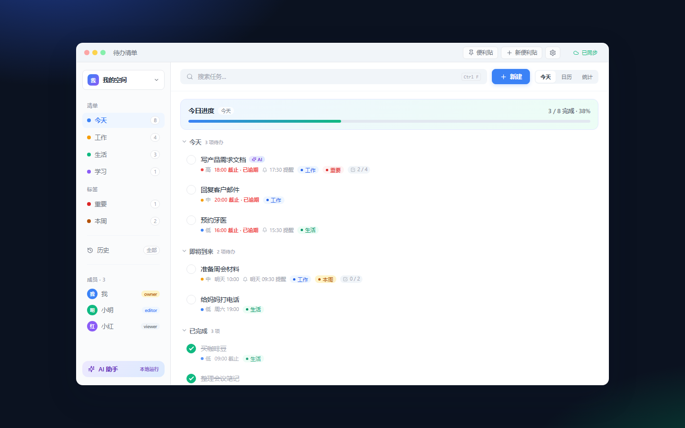
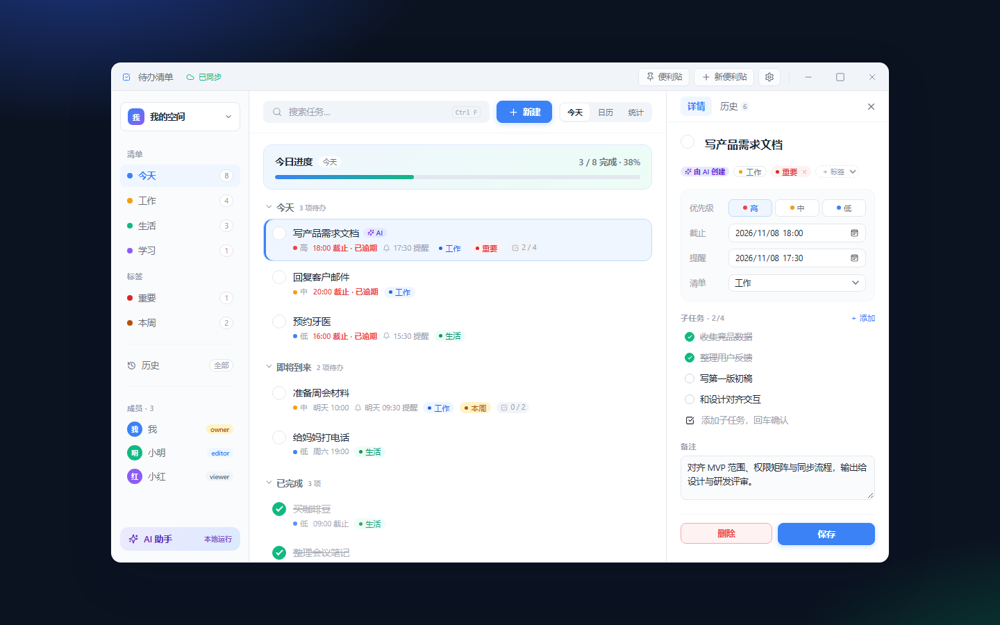
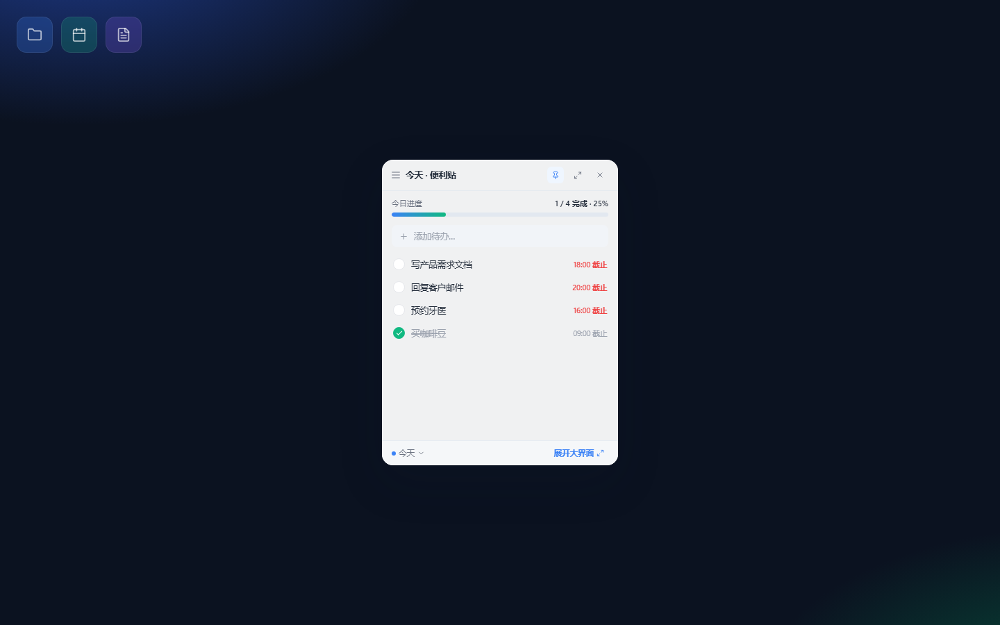
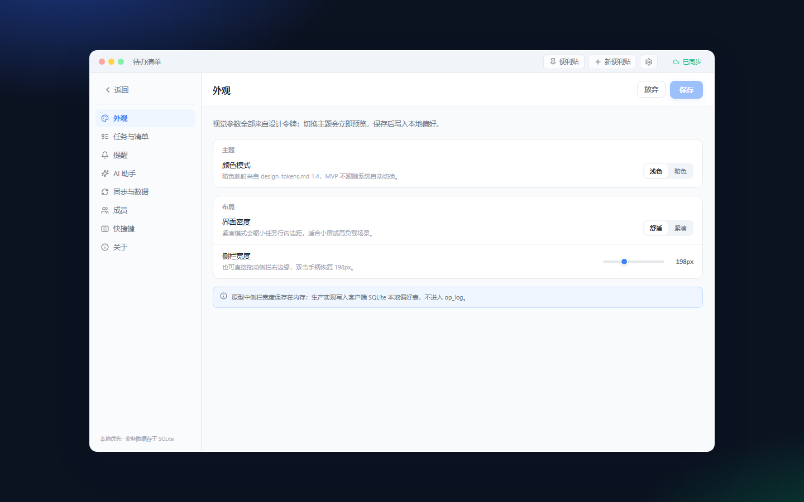

# 待办清单 · Windows 端 UI 原型

按 `docs/` 设计文档实现的 Windows 端界面原型：Tauri 2 + Svelte 5 + Vite，设计令牌与 `docs/design-tokens.md` 一致。

> 数据层已切换为 **Rust + SQLite `op_log` 投影**：主窗口与所有便利贴窗口都通过 Tauri 命令读取同一份投影，写操作生成 op 并广播 `projection-updated`。浏览器预览（`npm run dev`）没有 Tauri 运行时，自动降级为内存演示数据，仅供视觉与交互验收。

## 快速查看

### 方式一：浏览器预览（最快）

```bat
cd windows
npm install
npm run dev
```

打开 <http://127.0.0.1:1420>。或直接双击 [`start-preview.bat`](start-preview.bat)。

### 方式二：原生 Windows 窗口

```bat
cd windows
npm install
npm run tauri dev
```

或双击 [`start-desktop.bat`](start-desktop.bat)。需要 Node.js、Rust 与 MinGW/MSVC 链接器；脚本会自动寻找 WinLibs。

已构建的 release 桌面版可直接运行 [`desktop/TodoWindows.exe`](desktop/TodoWindows.exe)（同目录需保留 `WebView2Loader.dll`），或双击 [`run-built.bat`](run-built.bat)。

> 说明：当前机器上 WebView2 的初始逻辑视口为 800×600，原生窗口的三栏布局在该视口下仍可用；若要看设计稿 1120×720 的完整比例，请使用浏览器预览（同一套前端）。

## 预览截图

| 主界面 | 详情抽屉 |
| --- | --- |
|  |  |

| 主窗口便利贴 | 设置 |
| --- | --- |
|  |  |

更多截图：`shots/calendar.png`、`shots/stats.png`、`shots/global.png`、`shots/dark.png`、`shots/ai.png`、`shots/floating.png`。

## 已实现内容

- **S1 主窗口**：Windows 11 风格自绘标题栏（左侧图标、标题、同步状态；右侧业务按钮与最小化/最大化/关闭，控制按钮贴窗口右边缘，最大化后切换为还原图标）、可拖拽侧栏（150–300px，双击重置）、清单/标签/成员/AI 入口。
- **Rust 数据层**：SQLite `op_log` 只追加；HLC 全序、字段级 LWW、标签与子任务 OR-Set、确定性投影 reducer；写操作同事务写 `op_log` + 推进 `local_hlc` + 广播 `projection-updated`。
- **多工作区**：侧栏工作区切换 popover，支持切换与新建；`bootstrap` 按 `workspace_id` 读取工作区、成员、清单、标签、任务与历史；`active_workspace_id` 存本地偏好。
- **成员列表**：侧栏与设置页均来自 `membership` 投影，按当前工作区过滤，角色徽章中文化；支持角色变更与移除（本地模拟，未连接服务端）。
- **AI 密钥**：设置页密钥框可编辑、可显示/隐藏、可保存/清除，状态徽章「已配置/未配置」；Windows 落 Credential Manager，明文不写 SQLite / op_log / 日志；未配置时 AI 生成按钮禁用并引导到设置。
- **独立便利贴窗口（S2/S3）**：点击「便利贴」隐藏主窗口并由 Rust 创建 `sticky-main` 独立 `WebviewWindow`；浮动便利贴各自独立窗口，最多 5 个；所有窗口从 Rust 投影取数并监听 `projection-updated`。
- **任务**：分组（今天/即将到来/已完成）、优先级、截止与提醒、标签 chip、子任务进度、AI 徽章、逾期高亮、拖拽排序。
- **详情抽屉**：320px 固定宽、详情/历史 Tab、字段编辑、标签增删、子任务增删勾选、备注、删除确认、保存生成历史 op。
- **历史时间线**：人工/AI/系统节点样式、全部/仅 AI/仅我筛选、diff、op_id/model/source、撤销生成反向 op（不删除原 op）。
- **全局历史（S4）**：侧栏入口、跨任务时间线、点击任务跳转。
- **设置覆盖层**：外观（浅色/暗色、密度、侧栏宽度）、任务、提醒、AI、同步与数据、成员、快捷键、关于；脏状态、保存/放弃。
- **AI 助手**：本地端点、提示词快捷项、生成草案、确认写入（`source="ai"`），历史可撤销。
- **快捷添加与右键菜单**：延期、钉为便利贴、查看历史、删除。
- **键盘**：`Esc`、`Ctrl+N`、`Ctrl+F`、`Ctrl+Shift+T`、`Ctrl+,`、`Ctrl+Enter`、`↑/↓`、`Enter`、`Space`。
- **视觉**：暗色令牌、焦点环、骨架屏、空态、错误提示、`prefers-reduced-motion`、图标全部替换为 `lucide-svelte`（无 emoji 图标）。

## 演示状态参数

浏览器预览可用查询参数直接打开某个界面，便于逐屏查看：

| 参数 | 效果 |
| --- | --- |
| `?demo=detail` | 打开首条任务详情 |
| `?demo=history` | 打开首条任务历史 |
| `?demo=global` | 打开全局历史 |
| `?demo=settings` | 打开设置 |
| `?demo=ai` | 打开 AI 助手 |
| `?demo=sticky` | 主窗口收起为便利贴 |
| `?demo=floating` | 打开 2 个浮动便利贴 |
| `?demo=calendar` | 日历视图 |
| `?demo=stats` | 统计视图 |
| `?demo=dark` | 暗色模式 |
| `?skeleton=1` | 演示任务列表骨架屏（默认直接出内容，无模拟加载延迟） |

例如 <http://127.0.0.1:1420/?demo=detail>。

## 目录

```text
windows/
├── src/
│   ├── styles/tokens.css         设计令牌（唯一视觉参数来源）
│   ├── lib/
│   │   ├── types.ts              Task / Workspace / Member / HistoryOp / Settings 等领域类型
│   │   ├── utils.ts              时间、截止、优先级格式化
│   │   ├── demo-data.ts          浏览器预览用的内存演示数据（Tauri 模式不加载）
│   │   ├── ipc.ts                Tauri 命令薄封装 + 浏览器降级路由
│   │   └── store.svelte.ts       投影缓存、工作区切换、写操作、设置
│   ├── components/               TitleBar / Sidebar / WorkspaceSwitcher / TaskRow / DetailDrawer …
│   ├── StickyApp.svelte          独立便利贴窗口的轻量入口
│   ├── sticky-main.ts            sticky.html 的启动脚本
│   └── App.svelte                主窗口三栏布局、快捷键、窗口控制
├── sticky.html                   便利贴独立 Vite 入口
├── src-tauri/src/
│   ├── lib.rs                    Tauri Builder、命令注册、窗口生命周期
│   ├── core_domain.rs            HLC / op / LWW / OR-Set / reducer
│   ├── storage.rs                SQLite schema、迁移、op_log、本地偏好
│   ├── commands.rs               bootstrap / task / workspace / history / settings / ai key
│   └── windows.rs                sticky 窗口创建、关闭、主窗口显示隐藏
├── scripts/                      Edge/Puppeteer 视觉验收与原生窗口枚举脚本
├── desktop/                      已构建的调试版 exe
└── shots/                        验收截图
```

## 与设计文档的对应

| 文档 | 实现 |
| --- | --- |
| `docs/design-tokens.md` | [`src/styles/tokens.css`](src/styles/tokens.css) |
| `docs/windows-frontend-spec.md` | Svelte 5 Runes、无外部状态库、前端不持久化业务数据 |
| `docs/ui-implementation-spec.md` S1 | [`App.svelte`](src/App.svelte)、[`TaskRow.svelte`](src/components/TaskRow.svelte)、[`DetailDrawer.svelte`](src/components/DetailDrawer.svelte) |
| S2 / S3 便利贴 | [`sticky.html`](sticky.html)、[`StickyApp.svelte`](src/StickyApp.svelte)、[`StickyMode.svelte`](src/components/StickyMode.svelte)、[`FloatingSticky.svelte`](src/components/FloatingSticky.svelte) |
| S4 全局历史 | [`GlobalHistory.svelte`](src/components/GlobalHistory.svelte)、[`HistoryTimeline.svelte`](src/components/HistoryTimeline.svelte) |
| 工作区与成员 | [`WorkspaceSwitcher.svelte`](src/components/WorkspaceSwitcher.svelte)、[`Sidebar.svelte`](src/components/Sidebar.svelte)、[`SettingsOverlay.svelte`](src/components/SettingsOverlay.svelte) |
| 设置与快捷键 | [`SettingsOverlay.svelte`](src/components/SettingsOverlay.svelte) |
| `docs/ai-local-integration.md` | [`AiModal.svelte`](src/components/AiModal.svelte)，写入 `source="ai"`，历史可撤销；密钥走 Rust + Credential Manager |

## 常用命令

```bat
npm run dev             # 浏览器预览
npm run build           # 前端生产构建（含 index.html + sticky.html 多入口）
npm run check           # svelte-check
npm run tauri dev       # 原生窗口开发
npm run tauri:build     # 原生构建（no bundle）
npm run shoot           # 用 Edge 批量截图（需先启动 dev）
npm run interact        # 端到端交互回归（需先启动 dev）
npm run verify:changes  # 工作区/成员/密钥/独立便利贴专项验收（需先启动 dev）
npm run verify:native   # 原生双窗口 + Rust 投影 DOM 自检（需先构建调试版）
```

原生构建说明：本机使用 `x86_64-pc-windows-gnu`，Tauri 的 `crate-type` 已收窄为 `rlib`，避免 MinGW/UCRT 下 cdylib 导出序号过大；`start-desktop.bat` / `build-desktop.bat` 会把 WinLibs 加入 `PATH`，并把 `CARGO_TARGET_DIR` 指到 `%TEMP%\todo-target`。在中文路径下直接 `cargo check` 可能触发 MinGW 临时文件链接失败，请沿用脚本环境。

## 双窗口自检

`npm run verify:native` 会以 `TODO_VERIFY_WINDOWS=1` 启动调试版，自动创建主形态便利贴窗口，读取实际 WebviewWindow 列表与两个窗口的 DOM 状态后退出。预期输出：

```text
windows=2
main
sticky-main
mainDom=http://127.0.0.1:1420/#MAIN_OK:8
stickyDom=http://127.0.0.1:1420/sticky.html#STICKY_OK:4
```

`MAIN_OK` / `STICKY_OK` 表示两个窗口都成功从 Rust `op_log` 投影加载了任务；`STICKY_ERROR` 表示便利贴初始化投影失败。该自检钩子只在 `debug_assertions` 构建中存在。

## 后续工作

1. 用 `tauri-specta` 生成 `src/lib/ipc-bindings.generated.ts`，替换手写 DTO，CI 校验生成结果无 diff。
2. 接入服务端 `/v1/sync/push`、`/v1/sync/pull`，把本地 `pending_ops` 推送并按 cursor 拉取；当前 `syncNow` 仍为本地模拟。
3. 通知接 `tauri-plugin-notifications`，实现 `remind_at` 调度与补发。
4. Android 端按同一套 `op_log` reducer 与 `shared/testvectors/` 实现。
